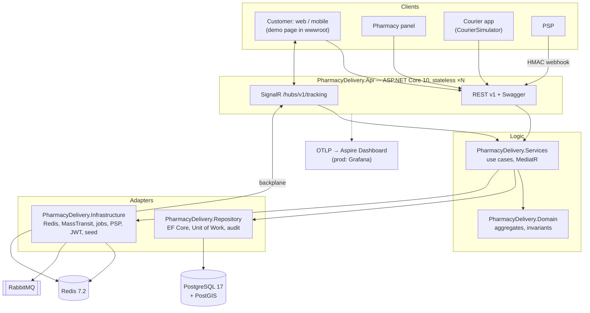
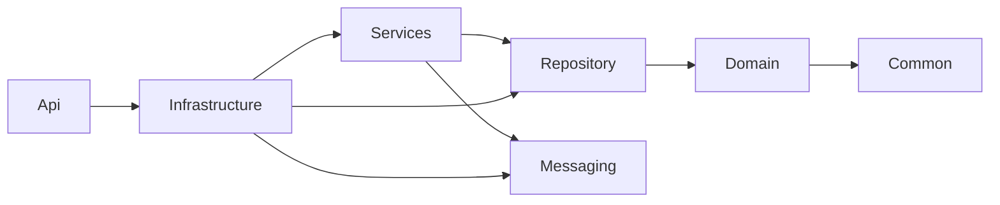
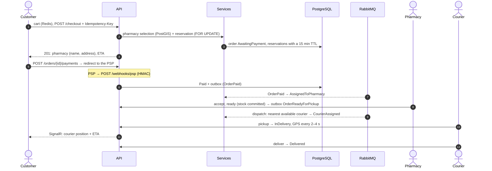
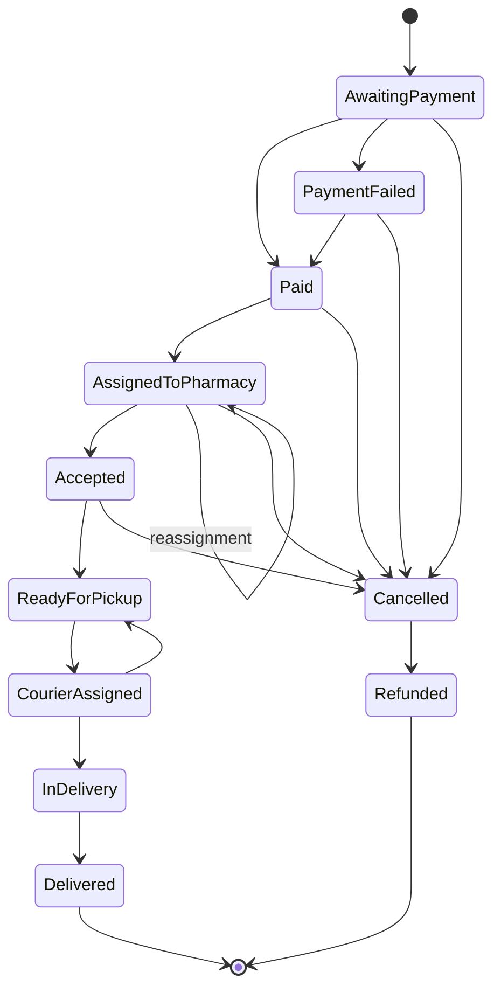
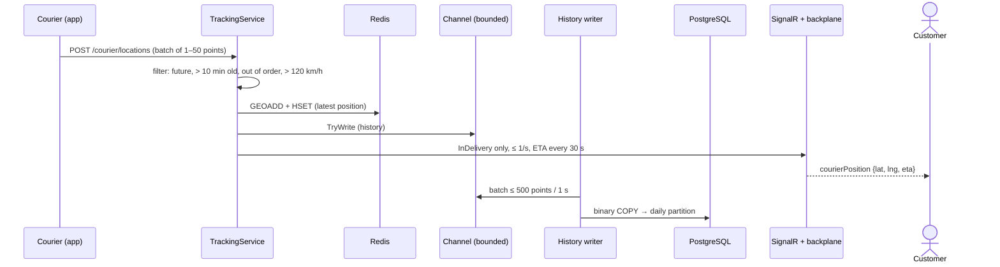

# Design document: quick-commerce order handling for pharmacies

> Assignment: *The customer puts together an order for pharmaceutical products and goes through a standard shopping cart. After placing the order, the customer learns which pharmacy the delivery will come from and sees the courier's route in real time.*
>
> The document describes the architecture and the decisions behind it; the repository contains a working implementation (.NET 10). Details: [configuration](docs/configuration.md) · [database and indexes](docs/database.md) · [UML diagrams](docs/uml.md) · [test plan](docs/test-plan.md) · [libraries and licenses](docs/third-party.md).

## Contents

0. [Glossary](#glossary)
1. [Goal and scope](#1-goal-and-scope)
2. [Simplifying assumptions](#2-simplifying-assumptions)
3. [Requirements](#3-requirements)
4. [Architecture](#4-architecture)
5. [Domain model (DDD)](#5-domain-model-ddd)
6. [Order flow and pharmacy selection](#6-order-flow-and-pharmacy-selection)
7. [Order state machine](#7-order-state-machine)
8. [Real-time courier tracking](#8-real-time-courier-tracking)
9. [Database and indexes](#9-database-and-indexes)
10. [Concurrency and locking](#10-concurrency-and-locking)
11. [Asynchronous messaging](#11-asynchronous-messaging)
12. [Cache](#12-cache)
13. [API, DTOs, validation, errors, JSON](#13-api-dtos-validation-errors-json)
14. [Versioning](#14-versioning)
15. [Security](#15-security)
16. [Change audit](#16-change-audit)
17. [Logging and observability](#17-logging-and-observability)
18. [Environments, configuration and seed data](#18-environments-configuration-and-seed-data)
19. [Tests](#19-tests)
20. [Deployment](#20-deployment)
21. [Scaling and next steps](#21-scaling-and-next-steps)

---

## Glossary

**Domain**

| Term | Name in code | Meaning |
|---|---|---|
| q-commerce | – | Quick commerce: delivery within tens of minutes from a local point (here: a partner pharmacy) |
| Partner pharmacy | `Pharmacy` | A pharmacy that fulfills orders; it has a location (PostGIS), opening hours and stock |
| OTC product | `Product` | A non-prescription (over-the-counter) medicine or product; the only scope of the MVP |
| Stock item | `StockItem` | Quantity of a product at a pharmacy: `OnHand` (physically on the shelf) and `Reserved`; `Available = OnHand − Reserved` |
| Reservation | `StockReservation` | Quantity set aside for an order; an unpaid one expires after 15 min, after packing it is *committed* |
| Cart | `Cart` | The customer's list of products and quantities in Redis (no prices — prices always come from the catalog) |
| Checkout | `ICheckoutService` | Placing an order: pharmacy selection + reservation + order creation |
| Pharmacy selection / ranking | `IPharmacySelector`, `PharmacyRankingPolicy` | Finding pharmacies within the radius that have the whole cart and ranking them by expected delivery time |
| Reassignment | `Reassign` | Moving a paid order to the next pharmacy after a rejection or when it is not accepted in time |
| Pharmacy queue | `PharmacyOrderSummary` | Active orders of a pharmacy (pharmacist panel) |
| Courier, delivery | `Courier`, `Delivery` | The person who delivers and their job for one order (`Assigned → InDelivery → Delivered`) |
| Dispatch | `IDispatchService` | Assigning the nearest available courier to a packed order |
| Tracking, GPS point | `ITrackingService`, `LocationPointInput` | Receiving courier positions and pushing them to the customer live |
| ETA | `EstimatedDeliveryAt` | Estimated time of arrival |
| PSP | `IPaymentGateway` | Payment service provider, e.g. Stripe; the payment status arrives through a webhook |
| Webhook | `PaymentWebhooksController` | An HTTP call from the PSP, signed with HMAC, reporting the payment result |
| Refund | `Refunded` | Money returned to the customer (cancellation after payment, payment after the reservation expired) |

**Architecture and technical terms**

| Term | Meaning in the project |
|---|---|
| Aggregate (aggregate root) | DDD consistency boundary; changed only through its methods (`Order`, `StockItem`, …) |
| Value object | Immutable object compared by value (`Money`, `GeoPoint`) |
| Domain event | A fact inside an aggregate (`OrderStatusChangedDomainEvent`), handled in-process by MediatR |
| Integration event | A message on the bus (`Contracts.V1.OrderPaid`), published through the outbox |
| Port / adapter | An interface in the service layer (`Abstract/`) and its implementation in Infrastructure/Repository (`Concrete/`) |
| Abstract / Concrete / Models | Folder convention: interfaces / implementations / models from interface signatures; `Abstract` and `Concrete` are split into area subfolders (`Concrete/Seed`, `Concrete/Jobs`, `Abstract/Tracking`…); one type per file |
| Unit of Work | Transaction boundary (`IUnitOfWork`): events → outbox, save, retry, error translation |
| Outbox / inbox | Tables of outgoing / processed messages in the same database — "change + message" atomicity and no double processing |
| DLQ (`_error`) | Queue of messages that could not be processed (dead letters) |
| Row lock | `SELECT … FOR UPDATE`; `SKIP LOCKED` — skip rows locked by others |
| `lock_timeout` | Maximum time to wait for a lock; after it, error 55P03 → 409 `stock.busy` |
| Advisory lock | PostgreSQL application lock (`pg_advisory_lock`) — here: one instance runs the migrations and the seed |
| Optimistic concurrency (`xmin`) | Detecting a concurrent change of a row on save |
| Idempotency | Repeating a request has the same effect (`Idempotency-Key`, unique indexes) |
| HybridCache | Two-level cache: process memory (L1) + Redis (L2), invalidation by tags |
| SignalR backplane | Redis distributes SignalR messages between API instances |
| Access / refresh token | Short-lived JWT for API calls / long random token to renew the session (rotated) |
| `jti`, denylist | Token identifier; list of revoked `jti` (Redis + database) |
| Seed, seed template | Initial data; a set chosen by name (`demo`, `empty`, `large`, test ones) |
| Test stand | The `Test` environment run with docker compose |
| Courier simulator | Separate process `PharmacyDelivery.CourierSimulator` that plays the couriers' mobile app (§8) |
| ProblemDetails | RFC 9457 error response standard (`code`, `traceId`) |
| Trace / span | OpenTelemetry trace of a whole request / one of its operations |

## 1. Goal and scope

The system takes orders for non-prescription pharmacy products, selects the partner pharmacy that will fulfill the order fastest, reserves the goods there, takes the payment, assigns a courier and shows the customer the courier's position on a live map.

**In the MVP scope:** catalog, cart, checkout with pharmacy selection and stock reservation, payment (PSP with a webhook), pharmacy panel (accept / reject / pack), courier dispatch, courier app (API + simulator), live tracking, accounts and sessions, audit, observability.

**Out of scope:** prescription medicines and e-prescriptions, splitting an order between pharmacies, scheduled deliveries (time slots), batching orders for one courier, route optimization, a real PSP adapter (there is a test "Fake PSP").

## 2. Simplifying assumptions

| # | Assumption | Why it simplifies |
|---|---|---|
| A1 | United States, launch in one city (demo data: New York City), time zone `America/New_York` | One currency (USD), one time zone for opening hours |
| A2 | Partner pharmacies; the system keeps a **copy of their stock** synchronized with their systems (pull every ~10 min + our own live reservations) | Reservations happen in our database, transactionally |
| A3 | **OTC** (non-prescription) products only | No e-prescription verification and no pharmacist consultation |
| A4 | An order is fulfilled by **one** pharmacy (the whole cart) | No split orders and no multiple couriers per order |
| A5 | **Prepayment** only (card / Apple Pay / Google Pay through the PSP), status through an HMAC webhook | No cash on delivery; one flow |
| A6 | Own courier fleet with an app that sends GPS every ~2–4 s | No 3PL integration; one telemetry format |
| A7 | Delivery radius ≤ 5 km, target 30–45 min | A simple geographic filter, ETA without a routing API (straight line × 1.3) |
| A8 | Scale: ~10k orders/day, peak ~1k/h, ~500 active couriers | A modular monolith and one database are enough (§21) |
| A9 | The address is geocoded by the customer app (it arrives with lat/lng) | No server-side geocoding service |

## 3. Requirements

**Functional**

| ID | Requirement |
|---|---|
| FR-1 | The customer browses the catalog, searches for products and manages the cart |
| FR-2 | Checkout selects a pharmacy able to fulfill the **whole** cart, reserves the goods and returns **the pharmacy's name and address** and the ETA |
| FR-3 | Payment through a PSP; a payment that arrives after the reservation expired is refunded automatically |
| FR-4 | The pharmacy accepts / rejects / packs the order; no reaction within 3 min → the order moves to the next pharmacy |
| FR-5 | A packed order gets the nearest available courier |
| FR-6 | The customer sees the courier's position and the ETA live (only while the order is "on the way" and only for their own order) |
| FR-7 | Accounts: registration, login, sessions, sign-out from all devices, password change |
| FR-8 | Administrator: price changes, blocking accounts, audit review, demo data reset |

**Non-functional**

| ID | Requirement | How it is met |
|---|---|---|
| NFR-1 | No overselling (oversell = 0) | Row locks + a CHECK in the database (§10); a test with 50 concurrent checkouts for 10 units |
| NFR-2 | End-to-end tracking latency < 3 s | Redis + SignalR, push ≤ 1/s per order (§8) |
| NFR-3 | Checkout availability 99.9% | Stateless API ×N, retries of transient errors, outbox instead of 2PC |
| NFR-4 | Idempotent checkout and webhooks | `Idempotency-Key` + unique indexes (§13, §9) |
| NFR-5 | Security per OWASP ASVS L2 (selected) | JWT ES256, immediate token revocation, NIST password policy, rate limiting (§15) |
| NFR-6 | Every data change through the API is audited | `[Audited]` + EF interceptor (§16) |
| NFR-7 | Observability: one `traceId` from the HTTP request through the bus to the SignalR push | OpenTelemetry (§17) |
| NFR-8 | Privacy (GDPR/CCPA): minimal personal data in logs and in the GPS history | Masking in logs, 30-day GPS retention (§15) |

## 4. Architecture

**Decision: a modular monolith (one deployable API process) with DDD layers + RabbitMQ for asynchronous work.**
Why: one team, one database, ACID transactions for the reservation without distributed sagas; the split into projects enforces boundaries like microservices would, and the tracking module (the busiest one) can be extracted without a rewrite (§21).



### Layers and dependencies



| Project | Responsibility | Rule (checked by an architecture test) |
|---|---|---|
| `PharmacyDelivery.Common` | error codes, application exceptions, JSON options, HMAC/hashing, time, Haversine, paging | BCL only, zero dependencies |
| `PharmacyDelivery.Domain` | aggregates, value objects, domain services, domain events | depends only on Common; no EF/MassTransit/MediatR |
| `PharmacyDelivery.Repository` | **everything about the database**: DbContext, EF configurations, migrations, repositories and NoTracking queries (`Concrete/`, each in its own file), their interfaces (`Abstract/`), read models (`Models/`), Unit of Work, PostgreSQL error translation, interceptors (audit, diagnostics) | no Services/Infrastructure/Api |
| `PharmacyDelivery.Services` | **service layer**: use cases and ports — interfaces in `Abstract/` (`ICheckoutService`, `ICartStore`, …), implementations in `Concrete/`, models from the signatures in `Models/`; MediatR | no EF Core, Npgsql, Redis |
| `PharmacyDelivery.Messaging` | integration event contracts `Contracts.V1`, bus policies | self-contained (primitives) |
| `PharmacyDelivery.Infrastructure` | port adapters (`Concrete/`): Redis, MassTransit (consumers), PSP, ETA, JWT, background jobs, seeders; `Abstract/ISeeder` | – |
| `PharmacyDelivery.Api` | controllers (thin, **one per file**), v1 DTOs, validators, hub, middleware, **all DI in one file** `DependencyInjection.cs` | controllers have no database access |
| `PharmacyDelivery.CourierSimulator` | separate host: simulates the courier mobile app (login, GPS, pickup, delivery) — needed to demonstrate tracking without a real app | depends only on Common |
| `PharmacyDelivery.Tests` | one test project (unit, architecture, integration); base classes `TestBase` and `IntegrationTestBase` | – |

Conventions: interfaces in the `Abstract/` folder (every interface and every method has XML documentation — checked by a test), implementations in `Concrete/`, models used in interfaces in `Models/`, one type per file. `Abstract/` and `Concrete/` are split into area subfolders, e.g. in Services: `Auth`, `Cart`, `Checkout`, `Stock`, `Payments`, `Orders`, `Pharmacies`, `Deliveries`, `Tracking`, `Events`; in Infrastructure: `Seed`, `Jobs`, `Messaging`, `Redis`, `Auth`, `Payments`, `Tracking`. A subfolder only groups files — the namespace stays `<Project>.Abstract` / `<Project>.Concrete`, so moving a file never changes a `using` (enforced by test `TC-7.21.9`). Every API action, the SignalR hub and the v1 DTOs also carry XML documentation, which Swagger shows.

Controller → service → (repository / port) → aggregate. Bus consumers and jobs call services too, never repositories — the business logic lives in one place.

### Key decisions (ADRs in brief)

| Decision | Alternative | Rationale |
|---|---|---|
| Reservation through `SELECT … FOR UPDATE` in PostgreSQL | Redis lock, optimistic concurrency | the database is the source of truth; transactional locks disappear when a process dies; with "hot" products the optimistic approach produces many retries |
| MassTransit outbox/inbox in the same database | publish after commit, 2PC | "change + message" atomicity without a distributed transaction; the inbox gives "effectively once" |
| MediatR **12.x** for domain events | hand-written dispatcher | standard pattern, a publishing pipeline with tracing; 13+ is commercial |
| MassTransit **8.x** | 9.x, plain RabbitMQ.Client | outbox/inbox, retry, harness tests; 9.x is commercial |
| SignalR + Redis backplane | SSE, polling, hand-written WebSocket | per-order groups, authorization, transport fallback, horizontal scaling |
| Own JWT issuer (ES256) + OIDC mode | Keycloak in compose, ASP.NET Identity | few moving parts in the demo; the same code works behind an external IdP (`Auth:Mode=Oidc`) |
| PostGIS (GiST + KNN) | geohash in Redis | one query combines geography, stock and pharmacy load |

## 5. Domain model (DDD)

Contexts: **Catalog** (Product), **Pharmacies and stock** (Pharmacy, StockItem, StockReservation), **Orders** (Order), **Payments** (Payment), **Deliveries** (Courier, Delivery), **Identity** (User, sessions, tokens). Full class diagram: [uml.md](docs/uml.md#classes--domain-model).

| Aggregate | Invariants |
|---|---|
| `Order` | transitions only according to the state machine; every change → a history entry + `OrderStatusChangedDomainEvent`; snapshot of prices and address |
| `StockItem` | `0 ≤ Reserved ≤ OnHand`; "all or nothing" cart reservation (`StockAllocator`) |
| `Payment` | finalized once; a duplicate notification is a no-op |
| `Delivery` / `Courier` | a courier has at most one active delivery; pickup before delivery |
| `User` | lockout after N failed logins; only the password hash is stored |

Identifiers are strongly typed (`OrderId`, `PharmacyId`…, Guid v7 generated by the application); value objects: `Money` (decimal, USD), `GeoPoint`, `DeliveryAddress`. Domain services: `PharmacyRankingPolicy` (ranking), `StockAllocator` (reservation of the whole cart).

**Domain events → MediatR → integration events.** An aggregate collects events; right before `SaveChanges`, `UnitOfWork` passes them to `IDomainEventDispatcher` (the MediatR implementation). The handlers run in the same transaction: `PublishOrderIntegrationEventsHandler` maps the event to `Contracts.V1` contracts and publishes them to the **outbox**, `LogOrderStatusChangeHandler` writes a business log. `TracingNotificationPublisher` wraps every handler in an OpenTelemetry span. The domain does not know MediatR (the `DomainEventNotification<T>` wrapper is created in the service layer).

## 6. Order flow and pharmacy selection



**Pharmacy selection** (`PharmacySelector`):
1. One PostGIS query: active pharmacies within the radius (`ST_DWithin`, GiST index) that have **all** lines in the required quantity (`on_hand − reserved ≥ qty`), together with the number of queued orders; KNN ordering `location <-> point`. The read takes **no locks** — the data may be slightly stale; locks are taken only for the reservation.
2. Pharmacies closed right now (opening hours in `America/New_York`) and pharmacies that already rejected this order are dropped.
3. Ranking: `preparation_time (5 min) + queue × 2 min + travel_time` — a slightly farther but idle pharmacy usually delivers sooner than the nearest busy one.
4. The reservation is attempted at the next pharmacies in turn (max. 3); no pharmacy within the radius → 422 `delivery.out_of_zone`, out of stock → 422 `checkout.no_pharmacy_available`.

The customer gets the pharmacy right in the checkout response, and if the order is later moved to another pharmacy — in the status update (SignalR) and in `GET /orders/{id}`.

**Reassignment** (rejection, or no acceptance within 3 min — job `AcceptanceTimeout`): the reservation is released, the next pharmacy is selected with the same algorithm (skipping the ones that rejected), a new reservation without expiry is created (the order is paid). No pharmacy → cancellation and an automatic refund.

## 7. Order state machine



The transition table lives in code (`OrderStateMachine`); a parameterized test checks every pair of statuses. A forbidden transition → `DomainException` `order.invalid_transition` → 422. The customer can cancel until the pharmacy accepts the order (paid → refund).

**Why an aggregate and not a MassTransit saga.** Transitions are triggered by synchronous commands (pharmacist, courier, PSP webhook) that must answer 409/422 right away, in the same transaction that holds the row locks of the order and the stock. A MassTransit saga (`MassTransitStateMachine`) is a message-driven process manager: it does not answer HTTP synchronously and keeps its own copy of the state, which would have to stay consistent with the aggregate. That is why the `Order` aggregate is the source of truth for the status. The asynchronous steps (`OrderPaid` → pharmacy, `OrderReadyForPickup` → dispatch) are orchestrated by consumers, and the timeouts (pharmacy acceptance, reservation expiry, dispatch retry) are jobs with `SKIP LOCKED` — RabbitMQ has no delayed delivery without a plugin. An order fulfillment saga with scheduled timeouts is the next step (§21).

## 8. Real-time courier tracking



- **Hot path without database writes:** the latest position goes to Redis (GEO for dispatch + a hash with the timestamp), the history goes through an in-memory queue (`Channel<T>` with `DropOldest`, a metric of dropped points) and is written in batches with **binary COPY** into a table partitioned by day. Reading a courier's active delivery is a **compiled query**.
- **Push:** SignalR group `order:{id}`; the client subscribes with the `SubscribeToOrder` method (the same access rule as `GET /orders/{id}`). Per-order throttling (`TrackingPushThrottle`, `Lock` from .NET 9) — ≤ 1 push/s, ETA recalculated every 30 s. The Redis backplane delivers the message to the client regardless of the API instance.
- **Privacy:** the courier's position is visible only to the customer of that order and only in status `InDelivery`; GPS history is kept for 30 days (partitions are dropped).
- **Fallback:** a client without WebSockets uses SignalR long polling or polls `GET /orders/{id}/tracking` every 5 s.
- **Courier simulator (`PharmacyDelivery.CourierSimulator`).** There is no real mobile app, so a separate process plays it for the 6 demo courier accounts: it signs in through `POST /auth/login`, asks for the current delivery every 2 s, an idle courier reports its position every 20 s (so that dispatch sees it as available), and an assigned courier drives in a straight line to the pharmacy (`pickup`) and to the customer (`deliver`), sending GPS points through exactly the same API as the app. This makes the courier move on the demo page's map; it uses only the public API and `PharmacyDelivery.Common` — it can be switched off without affecting the system.
- **Load:** 500 couriers × 1 point / 3 s ≈ 170 requests/s — little for one node; the history is ~170 rows/s in batches.

## 9. Database and indexes

Every index described in full, `EXPLAIN ANALYZE` measurements on 1M rows and monitoring: **[docs/database.md](docs/database.md)**. The most important decisions:

- every index serves a specific query; partial indexes for the "active" subsets (pharmacy queue, active reservations, active deliveries);
- **invariants in the database**: a partial unique index "one active delivery per courier", uniqueness of `(provider, provider_payment_id)` (webhook idempotency), `(customer_id, idempotency_key)`, CHECK `reserved ≤ on_hand`;
- PostGIS GiST + KNN for pharmacies, trigram GIN for search, BRIN + daily partitions for GPS;
- `stock_items` with `fillfactor = 80` and no indexes on the changing columns → HOT updates;
- `xmin` as the optimistic concurrency token (Order, Payment, Delivery, Courier, User, RefreshToken);
- reads: `AsNoTracking` + projections; writes: tracked aggregates; a test checks that the `ChangeTracker` is empty after every read.

## 10. Concurrency and locking

| Problem | Mechanism |
|---|---|
| Overselling with concurrent checkouts | Transaction: `SELECT … FROM stock_items WHERE … ORDER BY product_id FOR UPDATE` → `StockAllocator.ReserveAll` (check all lines first, then change) → save the reservations and the order → COMMIT. Locks are held for milliseconds |
| Deadlocks between carts with the same products | **Global lock order**: the order row first, then the stock rows ascending by `product_id`. Postgres locks rows in `ORDER BY` order (a LockRows node above Sort) |
| Waiting too long for a lock | `SET LOCAL lock_timeout` (2 s) → 55P03 → 409 `stock.busy`; checkout tries the next pharmacy |
| Deadlock / serialization failure / dropped connection | Npgsql execution strategy: the whole transactional operation is retried from scratch (`ChangeTracker.Clear()` at the start of each attempt) |
| Race "payment vs reservation expiry" | Both processes lock the order row first; the job uses `SKIP LOCKED`. If the order has been cancelled, the payment is refunded |
| Concurrent jobs on several instances | Candidates are read without locks, each order is claimed with `FOR UPDATE SKIP LOCKED` — no leader needed |
| Two instances assign the same courier | Redis lock `SET NX PX` with a token (released by a Lua script by the owner only) + a partial unique index in the database as the final guarantee |
| Two concurrent refreshes with the same refresh token | `xmin` on `refresh_tokens` → the second one gets a conflict |
| Migrations and seed with `--scale api=3` | `pg_advisory_lock` — one instance runs them, the others wait |
| Writing the GPS history under many concurrent requests | `Channel<T>` (many producers, one consumer), COPY batches |
| Push throttling (shared state) | `Dictionary` + `System.Threading.Lock` (a critical section of a few operations) |
| Limit of concurrent routing calls | `SemaphoreSlim(MaxConcurrentRequests)` |
| Stock synchronization of many pharmacies | `Parallel.ForEachAsync` (degree of parallelism from configuration), **a separate DI scope and DbContext per pharmacy** (DbContext is not thread-safe) |

Integration test: 50 customers concurrently buy a product with stock 10 → exactly 10 × 201, the rest 422, `reserved = 10` in the database, no 5xx.

## 11. Asynchronous messaging

RabbitMQ through **MassTransit 8.x**, with the **transactional EF Core outbox and inbox** in the same database:

| Event (`Contracts.V1`) | Published when | Consumer |
|---|---|---|
| `OrderStatusChanged` | every status change | SignalR push to the customer and the pharmacy panel |
| `OrderPaid` | the payment is booked | hands the order over to a pharmacy |
| `OrderReadyForPickup` | the pharmacy has packed the order | courier dispatch |
| `OrderAcceptedByPharmacy`, `DeliveryCompleted` | acceptance, delivery | for external systems (analytics, CRM) |

- the message is written to the `outbox_message` table in the transaction of the business change → the outbox delivery service sends it (`FOR UPDATE SKIP LOCKED`, safe with many instances);
- the consumer runs in a transaction with the **inbox** (`inbox_state`) — a redelivery of the same message does not change the state a second time;
- exponential retry for transient errors; `DomainException`, `BusinessRuleException`, `NotFoundException` are not retried → `_error` queue (dead letter);
- contracts: primitive types only, additive changes only, a breaking change = `Contracts.V2` published side by side; tolerant reader (unknown fields are ignored).

**Deliberately not through the bus:** the GPS stream (high frequency, only the latest position matters → Redis + an in-memory channel) and timeouts (pharmacy acceptance, reservation expiry → jobs that poll the database through partial indexes; no delayed-exchange plugin needed).

## 12. Cache

| Data | Where | Invalidation |
|---|---|---|
| Catalog (search, product), pharmacy list | **HybridCache**: L1 process memory (1 min) + L2 Redis (10 min), tags | price change → `RemoveByTagAsync("catalog")` |
| Cart | Redis, JSON with `schemaVersion`, TTL 24 h | customer writes / checkout |
| Latest courier position | Redis GEO + hash, TTL 1 day | every GPS point |
| Revoked tokens (`jti`) | Redis, TTL = remaining token lifetime | logout, blocking, password change |
| Courier assignment locks | Redis `SET NX PX` | owner (Lua) or TTL |

Prices in the cart are not cached — the cart stores only ids and quantities, and the price is always taken from the catalog and saved as a snapshot in the order. HybridCache protects against a "cache stampede" (one database read for many concurrent misses). Invalidating a tag clears L1 of the node and L2; other nodes may serve their L1 for up to 1 min — acceptable for the catalog.

## 13. API, DTOs, validation, errors, JSON

REST, version in the URL (`/api/v1`), **Swagger** documentation (`/swagger`) built from the XML comments of every action and DTO, with the Bearer scheme. The main endpoints:

| Method and path | Role | Description |
|---|---|---|
| `POST /api/v1/auth/register`, `login`, `refresh`, `logout`, `logout-all`, `change-password`; `GET me`, `GET/DELETE sessions` | – / signed in | accounts and sessions |
| `GET /api/v1/catalog/products`, `GET /catalog/products/{id}`, `GET /pharmacies` | anonymous | catalog, pharmacies |
| `GET/PUT/DELETE /api/v1/cart/items/{productId}` | Customer | cart |
| `POST /api/v1/checkout` (+ `Idempotency-Key`) | Customer | order; **the response contains the pharmacy and the ETA** |
| `GET /api/v1/orders`, `GET /orders/{id}`, `POST /orders/{id}/payments`, `POST /orders/{id}/cancel`, `GET /orders/{id}/tracking` | Customer (+ pharmacy/courier/admin for reading) | orders, payment, tracking (fallback) |
| `POST /api/v1/webhooks/psp` | PSP (HMAC) | payment status |
| `GET /api/v1/pharmacy/orders`, `POST …/{id}/accept`, `reject`, `ready` | Pharmacist | pharmacy panel |
| `GET /api/v1/courier/deliveries/current`, `POST …/{id}/pickup`, `deliver`, `POST /courier/locations` | Courier | courier app |
| `PUT /api/v1/admin/products/{id}/price`, `POST /admin/users/{id}/block`, `GET /admin/audit`, `POST /admin/maintenance/seed/reset` | Admin | administration |
| hub `/hubs/v1/tracking`: `SubscribeToOrder` → `orderStatusChanged`, `courierPosition` | signed in | real time |
| `GET /health/live`, `/health/ready`, `/.well-known/jwks.json` | anonymous | operations |

**DTOs** (`Contracts/V1`) are separate from the service models and entities; the mapping is explicit (`V1Mapping`). Controllers are thin (architecture test).

**Validation on three levels:**
1. request shape — FluentValidation for every DTO (filter `ValidationFilter`), e.g. a 5-digit ZIP code, coordinates, `quantity` 1–10, ≤ 50 GPS points;
2. domain invariants — in the aggregates (`DomainException` with a code);
3. use-case rules — in the services (empty cart, address out of zone).

**Errors** — RFC 9457 ProblemDetails through `IExceptionHandler`. Every response has a `code` (stable, machine-readable — the `ErrorCodes` catalog) and a `traceId` (= the OpenTelemetry trace).

| Exception | HTTP | Example codes |
|---|---|---|
| validation / malformed JSON / unknown field | 400 (+ `errors`) | `validation.failed`, `password.common` |
| authentication | 401 | `auth.invalid_credentials`, `auth.refresh_token_reused`, `payment.invalid_signature` |
| authorization | 403 | `resource.forbidden`, `auth.account_blocked` |
| missing resource **or someone else's resource** | 404 | `order.not_found` (we never reveal that someone else's order exists) |
| concurrency conflict / uniqueness | 409 | `stock.busy`, `concurrency.conflict`, `payment.duplicate` |
| business / domain rule | 422 | `stock.insufficient`, `delivery.out_of_zone`, `order.invalid_transition` |
| rate limit | 429 (+ `Retry-After`) | `request.rate_limited` |
| database unavailable / timeout | 503 (+ `Retry-After`) / 504 | `server.unavailable`, `database.timeout` |
| anything else | 500 | `server.error` — no details outside Development |

Database errors are translated by SQLSTATE and constraint name (`PostgresErrorTranslator`, [table](docs/database.md#database-errors--api)). Logs: 4xx — `Warning` without personal data, 5xx — `Error` with the exception.

**JSON** — System.Text.Json only, one configuration `PharmacyDeliveryJsonOptions` for the API, SignalR, MassTransit, Redis, seed and the simulator: camelCase, enums as strings (`"inDelivery"`), `null` omitted, ISO 8601 UTC dates, amounts as `decimal` in an `{amount, currency}` object, `MaxDepth = 32`. API input is **strict** (unknown field → 400), bus contracts and Redis data are **tolerant** (required for additive versioning). Domain types (strong ids, value objects) are never serialized directly.

## 14. Versioning

| What | How |
|---|---|
| REST API | `Asp.Versioning`, URL segment `/api/v{n}`, a Swagger document per version, headers `api-supported-versions` / `api-deprecated-versions`. Compatible changes stay in the same version; breaking changes get a new version, the old one is marked deprecated and kept for at least one release. An unknown version matches no route → 404 ProblemDetails |
| SignalR hub | version in the path (`/hubs/v1/tracking`), method names are part of the contract |
| Bus contracts | namespace `Contracts.V1`, additive changes only, V2 side by side for a breaking change |
| Application | SemVer from git tags (**MinVer**): tag `v1.2.0` → version `1.2.0`; visible in `/health`, Swagger, every log entry, the OTel `service.version` attribute and the image's OCI label |
| Database schema | forward-only EF Core migrations, expand/contract for rolling deploys |
| Cart in Redis | `schemaVersion` field, format migration on read |
| Changes | `CHANGELOG.md` (Keep a Changelog) |

## 15. Security

**Authentication** — `Auth:Mode = Local | Oidc`. The API is always a resource server that validates JWTs (`iss`, `aud`, `exp`, signature, `ValidAlgorithms = ES256`); in `Oidc` mode the tokens are issued by an external IdP and the controller code does not change.

- **Access token** — JWT ES256, 15 min, claims: `sub`, `role`, `sid`, `jti`, `pharmacy_id` / `courier_id`. The private key comes from a secret or a file (generated into a volume in compose); the public key is published at `/.well-known/jwks.json` (rotation through `kid`).
- **Tokens in the database, only as SHA-256 hashes**: `auth_sessions` (device), `refresh_tokens` (rotation chain), `access_tokens` (`jti` registry). Every request checks that its `jti` has not been revoked: the Redis denylist first (TTL until `exp`), the database when Redis is unavailable (fail-closed). Thanks to this, sign-out, account blocking and password change take effect **immediately**, not after 15 minutes.
- **Refresh token**: 256 bits of randomness, rotated on every use; **reuse of a used token = theft → the whole session is revoked**. Concurrent refreshes are resolved by `xmin`.
- **Password policy** (NIST SP 800-63B, `Auth:Password:*`): 12–128 Unicode characters after NFKC normalization, a list of the 10,000 most common passwords, no e-mail/name/"pharmacy" in the password, a history of 5 passwords, configurable composition rules (off by default), PBKDF2-HMAC-SHA512 with 100k iterations and automatic rehash on login. Lockout after 5 failed attempts for 15 min. **The same 401 response** for an unknown e-mail, a wrong password and a locked account; for an unknown e-mail a "dummy" hash is computed (protection against timing attacks).
- **SignalR**: the browser cannot send headers on a WebSocket, so the token goes in `access_token` (accepted only for `/hubs/*`, masked in logs).

**Authorization** — the default policy is "authentication required" (anonymous endpoints are explicit — architecture test), role policies `customer`, `pharmacist` (+ claim `pharmacy_id`), `courier` (+ `courier_id`), `admin`; resource rules: a customer sees their own orders, a pharmacy — its own, a courier — the assigned ones; someone else's resource → 404.

**Other:** PSP webhook with HMAC-SHA256 + timestamp (anti-replay) + constant-time comparison; rate limiting (login per IP, checkout per user, GPS per courier, global per IP); headers `X-Content-Type-Options`, `X-Frame-Options`, `Referrer-Policy`, `Permissions-Policy`, CSP (API: `default-src 'none'`; demo page: only the pinned CDN and OSM tiles), HSTS behind the ingress; a 256 KB request size limit; `X-Forwarded-*` trusted by default from loopback only; parameterized SQL (EF/Npgsql); no polymorphic deserialization; ProblemDetails without a stack trace outside Development.

**Privacy (GDPR/CCPA):** e-mails, phone numbers, tokens and passwords are masked in logs (`${mask-pii}`); identifiers instead of personal data; GPS history kept for 30 days; the audit masks password and token hashes; the Docker image is non-root, without a shell; secrets only in environment variables / volumes.

## 16. Change audit

API actions that change data carry the **`[Audited("order.cancel")]`** attribute or an explicit **`[AuditExempt("reason")]`** (an architecture test makes sure every POST/PUT/DELETE action has one of them).

- `AuditMiddleware` opens an audit context for a marked endpoint (action, user, role, method, path, `traceId`);
- `AuditSaveChangesInterceptor` (EF Core) writes, on every `SaveChanges` within that context, **the old and the new value** of every changed property to `audit_entries` / `audit_changes` (including complex properties, e.g. `Total.Amount`); for added and deleted entities — all values;
- audit entries are created **in the same transaction** as the change — a rolled-back operation leaves no audit, a committed one always has it;
- sensitive values (`PasswordHash`, `TokenHash`) are stored as `***`; bulk operations without tracking (`ExecuteUpdate`) are not used on audited paths;
- reading: `GET /api/v1/admin/audit?entityType=Order&entityId=…`; retention 365 days.

## 17. Logging and observability

**NLog** — configured in the `NLog` section of appsettings (different per environment): JSON to the console (Test/Staging/Prod), plain text (Development), rotated files in **daily folders, one file per level** (`logs/2026-10-21/info.log`, `warn.log`, `error.log`…). Every entry carries `traceId`, `spanId`, version and environment; the message goes through personal data masking. SQL errors are logged by an interceptor (SQLSTATE, constraint, duration, SQL **without parameter values**); slow queries > 500 ms — `Warning`.

**Framework logs go to the console only.** The `Microsoft.*` and `System.*` categories (from Warning; `Microsoft.Hosting.Lifetime` from Information) go only to the console (`docker compose logs`, OTLP export) — the NLog file holds application logs only, so it does not grow with framework noise and is easy to read.

**Startup report** (`StartupReport`, category `PharmacyDelivery.Startup`) — before accepting traffic, the application logs a tree: the host (environment, version, machine, OS, runtime, GC, time zone), **every configuration value with its source** (`appsettings.json`, `appsettings.Test.json`, environment variables — you can see who overrode a value) and the process's environment variables. Secrets are masked by key name and in the content (password in a connection string, credentials in a URL). In Production the environment variables branch is off (`StartupReport:IncludeEnvironmentVariables`).

```text
PharmacyDelivery API 0.1.0 — startup report
├─ Host
│  ├─ Environment: Test
│  └─ Runtime: .NET 10.0.13 (X64), server GC: True, CPUs: 4
├─ Configuration (appsettings.json → appsettings.Test.json → env; value ← source)
│  ├─ Admin
│  │  └─ MaintenanceEndpointsEnabled = True  ← appsettings.Test.json
│  └─ ConnectionStrings
│     └─ Postgres = Host=postgres;…;Password=***  ← env
└─ Environment variables (21)
   └─ Seed__UsersPassword = ***
```

**OpenTelemetry** — traces: ASP.NET Core, HttpClient, Npgsql (SQL), Redis, MassTransit, SignalR, custom business spans (`checkout`, `pharmacy.select`, `stock.reserve`, `pharmacy.reassign`, `dispatch.assign`, `tracking.ingest`, `domain-event …`). The W3C context flows through HTTP headers and MassTransit messages — **one trace from the PSP webhook through the outbox and RabbitMQ to the SignalR push**; the courier simulator is instrumented too. The `traceId` from ProblemDetails (and the `X-Trace-Id` header) is enough to find a request.

Custom metrics (`Meter "PharmacyDelivery"`): `pharmacy_delivery.orders.created`, `pharmacy_delivery.orders.delivered`, `pharmacy_delivery.checkout.duration`, `pharmacy_delivery.delivery.duration`, `pharmacy_delivery.stock.reservation_conflicts{reason}`, `pharmacy_delivery.reservations.expired`, `pharmacy_delivery.pharmacy.acceptance_timeouts`, `pharmacy_delivery.dispatch.no_courier`, `pharmacy_delivery.tracking.points_received`, `pharmacy_delivery.tracking.points_dropped{reason}`, `pharmacy_delivery.tracking.connections`; plus runtime, Kestrel, ASP.NET Core, MassTransit and Npgsql metrics.

OTLP export to the **Aspire Dashboard** in compose (traces, metrics and logs in one container); in production the same OTLP → OpenTelemetry Collector → Tempo / Prometheus / Loki (Grafana). Sampling `ParentBased(TraceIdRatio)`: 100% in Dev/Test, 10% in Production. Health checks: `/health/live` (process) and `/health/ready` (PostgreSQL, Redis, MassTransit bus) with version and environment.

## 18. Environments, configuration and seed data

Four environments; **we work on `Test`** (the docker compose stand):

| | Development | **Test** | Staging | Production |
|---|---|---|---|---|
| How it runs | `dotnet run` | docker compose | copy of the prod infrastructure | prod |
| Seed | `IfEmpty` + `demo` | `IfEmpty` + `demo`, `Reset` allowed | `IfEmpty` + `empty` | `None` |
| Data reset endpoint | yes | yes | no | no |
| Swagger | yes | yes | yes | no |
| PSP | Fake | Fake | Stripe (adapter out of scope) | Stripe |
| Courier simulator | yes | yes | no | no |
| JWT key | ephemeral if missing | from a volume (generated) | secret | secret |
| Exception details | yes | no | no | no |
| Logs | text, Debug | JSON, Information | JSON | JSON, Warning for `Microsoft.*` |

The environment only selects the file `appsettings.{Env}.json`; behavior is driven by settings (e.g. `Swagger:Enabled`, `Seed:AllowReset`, `Payments:Provider`). At startup `EnvironmentGuards` rejects dangerous combinations (Fake PSP in Production, an ephemeral JWT key outside Development, `Reset` without permission, a reset together with a real PSP). **Every setting is described in [docs/configuration.md](docs/configuration.md)** (a test checks completeness).

**Seed data** — the template is chosen by name with `Seed:Profile`; classes are marked `[SeedProfile("demo", Order = 20)]` (a class can belong to several templates). `Seed:Mode`:
- `IfEmpty` — fill an empty database (idempotent);
- `Reset` — **delete all data and fill it again**: `TRUNCATE … RESTART IDENTITY CASCADE` of all tables (with `lock_timeout` and a retry on deadlock), Redis keys with the `pharmacy-delivery:` prefix, optionally the RabbitMQ queues. Safeguards: `Seed:AllowReset`, an advisory lock (one instance), a marker in Redis (instances starting within 5 min do not repeat the reset);
- manually without a restart: `POST /api/v1/admin/maintenance/seed/reset` (Admin, Dev/Test only).

Templates: `empty` (admin only), `demo` (8 pharmacies in New York City — two open 24/7, 60 OTC products in 6 categories, varied stock with a scarce children's cough syrup, customers with addresses, pharmacists, 6 couriers with positions, history: a delivered order, a cancelled one with a refund and **one on the way**, which the simulator delivers right after startup), `large` (volume for measurements), and in tests `minimal`, `concurrency`, `reassign`, `dispatch` (attribute `[UseSeed("…")]`). The passwords of the demo accounts go through the same password policy; identifiers are deterministic.

## 19. Tests

One project `PharmacyDelivery.Tests`, 151 NUnit tests — 107 without Docker and 44 integration tests (Moq, Testcontainers, WebApplicationFactory, NetArchTest, MassTransit harness), a plan with numbered cases: **[docs/test-plan.md](docs/test-plan.md)**.

| Level | Examples |
|---|---|
| Unit (no Docker) | state machine (every pair of statuses), stock invariants, pharmacy ranking, password policy, HMAC, GPS filtering, throttling, SQLSTATE translation, seed registry, log masking |
| Architecture | layer dependencies, Common without dependencies, DI in one file only, every state-changing action audited, explicit anonymous endpoints |
| Integration (PostGIS, Redis, RabbitMQ in containers) | 50 concurrent checkouts for 10 units, no deadlocks, `lock_timeout`, expiry, payment through the bus, reassignment, dispatch, SignalR, token rotation and revocation, rate limiting, indexes (`EXPLAIN`), audit, OpenTelemetry |
| Documentation | every setting documented; the test plan matches the code (`[Property("TestCase","TC-7.4.1")]`) |
| E2E | `scripts/demo-order.py` on the Test stand + the demo page manually |

## 20. Deployment

- **Multistage Dockerfile**: `restore` (project files only → NuGet layer cache) → `build` → `test` (unit + architecture + documentation; reports `junit.xml`, `tests.trx`, `coverage.cobertura.xml`, exported by the `test-results` stage) → `publish` (no image when a test fails) → `runtime` on `aspnet:10.0-noble-chiseled-extra` (no shell, non-root, ICU + tzdata), `HEALTHCHECK` through `dotnet PharmacyDelivery.Api.dll --healthcheck` (the image has no curl), OCI labels with the version.
- **docker compose** (Test stand): API, simulator, PostgreSQL/PostGIS (with `pg_stat_statements`), Redis 7.2, RabbitMQ 4.1, Aspire Dashboard, a one-off `jwt-keygen`; startup dependencies through health checks.
- **CI** — GitHub Actions (`.github/workflows/ci.yml`: build + unit tests, integration tests on the runner's Docker, images with the tests inside, code style; test summary in the job summary, `v*` tag → GitHub Container Registry) and an equivalent **GitLab CI (`.gitlab-ci.yml`)**: style (ReSharper `cleanupcode` + `git diff --exit-code`) → API image build with the tests inside; the JUnit report goes to the MR test tab and Cobertura coverage to the diff (the report is exported even for a red run) → integration tests (Testcontainers on Docker-in-Docker) → simulator image → images pushed to the GitLab Container Registry (default branch and `v*` tags). **Build once, deploy many**: the same image goes `test` → `staging` → `production` (separate secrets per environment in the CI/CD variables, manual approval for production).
- Migrations run at startup under an advisory lock; in production they can move to a CD step (`Database:ApplyMigrationsOnStartup=false`).

## 21. Scaling and next steps

**The scale from the assumptions (A8)** is modest: ~0.3 orders/s at peak and ~170 GPS points/s. One API node and one PostgreSQL instance are more than enough; the API is stateless (state in Redis/Postgres, SignalR backplane), so it scales horizontally, and the jobs are safe on many instances (`SKIP LOCKED`, advisory lock).

Next steps when traffic grows:
1. **Extract the tracking module** into its own service (a separate host with `TrackingService`, Redis, SignalR) — it validates the same JWTs with the public key from JWKS; it is the most frequently called path.
2. PostgreSQL read replicas for the catalog and the order history; PgBouncer.
3. A cache of pharmacy candidates per (geohash, cart) for a few seconds; limit KNN to the N nearest.
4. A real routing API (OSRM / Google) behind the existing `IEtaService` port (the semaphore is already there).
5. An order fulfillment saga (`MassTransitStateMachine`, EF repository in PostgreSQL) with scheduled messages (`Schedule`: acceptance timeout, dispatch retry, reservation expiry; scheduler — the `rabbitmq_delayed_message_exchange` plugin or Quartz) instead of jobs that poll the database. The `Order` aggregate stays the source of truth for the status; the saga only orchestrates the steps and calls the services.
6. Features: e-prescriptions (Rx), split orders, batched deliveries, time slots, a real PSP adapter (Stripe) behind `IPaymentGateway`, the pharmacy panel as a separate application.

### Known limitations of the demo implementation

- The Stripe adapter is not implemented (the `Stripe` configuration deliberately stops the startup); the Fake PSP simulates the gateway and sends a real signed webhook.
- The ETA is a linear approximation (× 1.3), not road routing.
- GPS points with dates for which no partition has been created yet go to the default partition (see [database.md](docs/database.md)).
- Invalidating the catalog cache on other nodes happens when their L1 expires (up to 1 min).
