# Database and indexes

PostgreSQL 17 + PostGIS 3.5. The schema is created by EF Core migrations (`src/PharmacyDelivery.Repository/Migrations`); names are `snake_case`. ER diagram — [uml.md](uml.md#er).

## Principles

1. **Every index serves a specific query from the code** (table below). Indexes "just in case" slow writes down.
2. Indexes and constraints have **explicit names** (`HasDatabaseName`) — `PostgresErrorTranslator` maps a constraint name to an API error code.
3. **Partial indexes** where a query targets a small subset (active orders, active reservations, active deliveries).
4. **Business-critical invariants are also enforced by the database** (partial unique indexes, CHECK) — the last line of defense against a bug in the code or a race.
5. Production migrations: an index on a large table → `CREATE INDEX CONCURRENTLY` in a migration with `suppressTransaction: true` (skill `add-migration`). Schema changes follow **expand/contract** (add first, remove later), so that the old and the new application version can run side by side during a rolling deploy.

<!-- schema:begin -->

## Schema

This section is generated from the database after the migrations (`python scripts/generate-db-schema.py`) — do not edit it by hand. Conventions: `snake_case` names, `uuid` keys (Guid v7 assigned by the application), `timestamptz` times (UTC), amounts as `numeric(12,2)` + currency, explicit constraint names (mapped to API error codes — section "Database errors → API"). Non-unique indexes are described in the "Indexes" section.

### ER diagram

```mermaid
erDiagram
    auth_sessions ||--o{ access_tokens : "session_id"
    audit_entries ||--o{ audit_changes : "audit_entry_id"
    users ||--o{ auth_sessions : "user_id"
    couriers ||--o{ deliveries : "courier_id"
    orders ||--o{ deliveries : "order_id"
    orders ||--o{ order_items : "order_id"
    orders ||--o{ order_status_history : "order_id"
    pharmacies ||--o{ orders : "pharmacy_id"
    inbox_state ||--o{ outbox_message : "inbox_message_id, inbox_consumer_id"
    outbox_state ||--o{ outbox_message : "outbox_id"
    users ||--o{ password_history : "user_id"
    orders ||--o{ payments : "order_id"
    auth_sessions ||--o{ refresh_tokens : "session_id"
    pharmacies ||--o{ stock_items : "pharmacy_id"
    products ||--o{ stock_items : "product_id"
    products {
        uuid id PK
        character_varying name
        character_varying ean
        character_varying category
        character_varying description
        boolean is_active
        numeric price_amount
        character_varying price_currency
    }
    pharmacies {
        uuid id PK
        character_varying code
        character_varying name
        character_varying street
        character_varying city
        character_varying postal_code
        geography location
        boolean is_active
        jsonb opening_hours
    }
    stock_items {
        uuid pharmacy_id PK
        uuid product_id PK
        integer on_hand
        integer reserved
        timestamp_with_time_zone updated_at
    }
    stock_reservations {
        uuid id PK
        uuid order_id
        uuid pharmacy_id
        uuid product_id
        integer quantity
        character_varying status
        timestamp_with_time_zone created_at
        timestamp_with_time_zone expires_at
        timestamp_with_time_zone closed_at
    }
    orders {
        uuid id PK
        character_varying number
        uuid customer_id
        uuid pharmacy_id FK
        character_varying status
        character_varying idempotency_key
        timestamp_with_time_zone created_at
        timestamp_with_time_zone updated_at
        timestamp_with_time_zone paid_at
        timestamp_with_time_zone assigned_at
        timestamp_with_time_zone delivered_at
        timestamp_with_time_zone estimated_delivery_at
        character_varying cancellation_reason
        uuid rejected_pharmacy_ids
        numeric total_amount
        character_varying total_currency
        jsonb delivery_address
    }
    order_items {
        uuid id PK
        uuid order_id FK
        uuid product_id
        character_varying product_name
        integer quantity
        numeric unit_price_amount
        character_varying unit_price_currency
    }
    order_status_history {
        uuid id PK
        uuid order_id FK
        character_varying from_status
        character_varying to_status
        timestamp_with_time_zone occurred_at
        character_varying reason
    }
    payments {
        uuid id PK
        uuid order_id FK
        character_varying provider
        character_varying provider_payment_id
        character_varying status
        timestamp_with_time_zone created_at
        timestamp_with_time_zone completed_at
        numeric amount
        character_varying currency
    }
    couriers {
        uuid id PK
        uuid user_id
        character_varying display_name
        character_varying status
    }
    deliveries {
        uuid id PK
        uuid order_id FK
        uuid courier_id FK
        uuid pharmacy_id
        character_varying status
        timestamp_with_time_zone assigned_at
        timestamp_with_time_zone picked_up_at
        timestamp_with_time_zone delivered_at
    }
    courier_locations {
        bigint id PK
        uuid courier_id
        uuid delivery_id
        double_precision latitude
        double_precision longitude
        double_precision speed_kmh
        timestamp_with_time_zone recorded_at PK
    }
    users {
        uuid id PK
        character_varying email
        character_varying normalized_email
        character_varying display_name
        character_varying role
        character_varying password_hash
        uuid pharmacy_id
        uuid courier_id
        integer failed_login_attempts
        timestamp_with_time_zone lockout_ends_at
        boolean is_blocked
        timestamp_with_time_zone created_at
        timestamp_with_time_zone password_changed_at
        jsonb addresses
    }
    password_history {
        uuid id PK
        uuid user_id FK
        character_varying password_hash
        timestamp_with_time_zone created_at
    }
    auth_sessions {
        uuid id PK
        uuid user_id FK
        character_varying user_agent
        character_varying ip_address
        timestamp_with_time_zone created_at
        timestamp_with_time_zone last_used_at
        timestamp_with_time_zone revoked_at
        character_varying revoke_reason
    }
    refresh_tokens {
        uuid id PK
        uuid session_id FK
        character_varying token_hash
        timestamp_with_time_zone created_at
        timestamp_with_time_zone expires_at
        timestamp_with_time_zone used_at
        uuid replaced_by_id
        timestamp_with_time_zone revoked_at
    }
    access_tokens {
        uuid jti PK
        uuid session_id FK
        uuid user_id
        timestamp_with_time_zone created_at
        timestamp_with_time_zone expires_at
        timestamp_with_time_zone revoked_at
    }
    audit_entries {
        uuid id PK
        timestamp_with_time_zone occurred_at
        character_varying action
        uuid user_id
        character_varying role
        character_varying http_method
        character_varying path
        character_varying trace_id
    }
    audit_changes {
        bigint id PK
        uuid audit_entry_id FK
        character_varying entity_type
        character_varying entity_id
        character_varying change_type
        character_varying property
        text old_value
        text new_value
    }
    inbox_state {
        bigint id PK
        uuid message_id
        uuid consumer_id
        uuid lock_id
        bytea row_version
        timestamp_with_time_zone received
        integer receive_count
        timestamp_with_time_zone expiration_time
        timestamp_with_time_zone consumed
        timestamp_with_time_zone delivered
        bigint last_sequence_number
    }
    outbox_message {
        bigint sequence_number PK
        timestamp_with_time_zone enqueue_time
        timestamp_with_time_zone sent_time
        text headers
        text properties
        uuid inbox_message_id FK
        uuid inbox_consumer_id FK
        uuid outbox_id FK
        uuid message_id
        character_varying content_type
        text message_type
        text body
        uuid conversation_id
        uuid correlation_id
        uuid initiator_id
        uuid request_id
        character_varying source_address
        character_varying destination_address
        character_varying response_address
        character_varying fault_address
        timestamp_with_time_zone expiration_time
    }
    outbox_state {
        uuid outbox_id PK
        uuid lock_id
        bytea row_version
        timestamp_with_time_zone created
        timestamp_with_time_zone delivered
        bigint last_sequence_number
    }
```



### Catalog

#### `products`

OTC products: name, EAN, category, price (`price_amount` + `price_currency`), active flag. Searched through `pg_trgm`.

| Column | Type | NULL | Default |
|---|---|---|---|
| `id` | `uuid` | no |  |
| `name` | `character varying(200)` | no |  |
| `ean` | `character varying(14)` | no |  |
| `category` | `character varying(32)` | no |  |
| `description` | `character varying(2000)` | no |  |
| `is_active` | `boolean` | no |  |
| `price_amount` | `numeric(12,2)` | no |  |
| `price_currency` | `character varying(3)` | no |  |

| Constraint | Kind | Definition |
|---|---|---|
| `pk_products` | PK | `PRIMARY KEY (id)` |
| `ux_products_ean` | UNIQUE (index) | `UNIQUE btree (ean)` |

### Pharmacies and stock

#### `pharmacies`

Partner pharmacies: code, address, PostGIS location (`geography(Point)`), opening hours as `jsonb` (time zone America/New_York).

| Column | Type | NULL | Default |
|---|---|---|---|
| `id` | `uuid` | no |  |
| `code` | `character varying(32)` | no |  |
| `name` | `character varying(200)` | no |  |
| `street` | `character varying(200)` | no |  |
| `city` | `character varying(100)` | no |  |
| `postal_code` | `character varying(6)` | no |  |
| `location` | `geography(Point,4326)` | no |  |
| `is_active` | `boolean` | no |  |
| `opening_hours` | `jsonb` | no |  |

| Constraint | Kind | Definition |
|---|---|---|
| `pk_pharmacies` | PK | `PRIMARY KEY (id)` |
| `ux_pharmacies_code` | UNIQUE (index) | `UNIQUE btree (code)` |

#### `stock_items`

Stock of a product at a pharmacy: `on_hand` (on the shelf) and `reserved`; `available = on_hand − reserved`. The row is locked `FOR UPDATE` during a reservation; `fillfactor = 80` for HOT updates.

| Column | Type | NULL | Default |
|---|---|---|---|
| `pharmacy_id` | `uuid` | no |  |
| `product_id` | `uuid` | no |  |
| `on_hand` | `integer` | no |  |
| `reserved` | `integer` | no |  |
| `updated_at` | `timestamp with time zone` | no |  |

| Constraint | Kind | Definition |
|---|---|---|
| `ck_stock_items_quantities` | CHECK | `CHECK (((on_hand >= 0) AND (reserved >= 0) AND (reserved <= on_hand)))` |
| `fk_stock_items_pharmacies_pharmacy_id` | FK | `FOREIGN KEY (pharmacy_id) REFERENCES pharmacies(id) ON DELETE RESTRICT` |
| `fk_stock_items_products_product_id` | FK | `FOREIGN KEY (product_id) REFERENCES products(id) ON DELETE RESTRICT` |
| `pk_stock_items` | PK | `PRIMARY KEY (pharmacy_id, product_id)` |

#### `stock_reservations`

Reservations of order lines: `Active` → `Committed` (goods handed over) or `Released` (cancellation, reassignment, expiry after `expires_at`).

| Column | Type | NULL | Default |
|---|---|---|---|
| `id` | `uuid` | no |  |
| `order_id` | `uuid` | no |  |
| `pharmacy_id` | `uuid` | no |  |
| `product_id` | `uuid` | no |  |
| `quantity` | `integer` | no |  |
| `status` | `character varying(32)` | no |  |
| `created_at` | `timestamp with time zone` | no |  |
| `expires_at` | `timestamp with time zone` | yes |  |
| `closed_at` | `timestamp with time zone` | yes |  |

| Constraint | Kind | Definition |
|---|---|---|
| `pk_stock_reservations` | PK | `PRIMARY KEY (id)` |

### Orders

#### `orders`

Order aggregate: customer, fulfilling pharmacy, state machine status, total, delivery address (`jsonb`), ETA, checkout idempotency key, pharmacies that rejected the order. Optimistic concurrency through `xmin`.

| Column | Type | NULL | Default |
|---|---|---|---|
| `id` | `uuid` | no |  |
| `number` | `character varying(20)` | no |  |
| `customer_id` | `uuid` | no |  |
| `pharmacy_id` | `uuid` | no |  |
| `status` | `character varying(32)` | no |  |
| `idempotency_key` | `character varying(64)` | no |  |
| `created_at` | `timestamp with time zone` | no |  |
| `updated_at` | `timestamp with time zone` | no |  |
| `paid_at` | `timestamp with time zone` | yes |  |
| `assigned_at` | `timestamp with time zone` | yes |  |
| `delivered_at` | `timestamp with time zone` | yes |  |
| `estimated_delivery_at` | `timestamp with time zone` | no |  |
| `cancellation_reason` | `character varying(500)` | yes |  |
| `rejected_pharmacy_ids` | `uuid[]` | no |  |
| `total_amount` | `numeric(12,2)` | no |  |
| `total_currency` | `character varying(3)` | no |  |
| `delivery_address` | `jsonb` | no |  |

| Constraint | Kind | Definition |
|---|---|---|
| `fk_orders_pharmacies_pharmacy_id` | FK | `FOREIGN KEY (pharmacy_id) REFERENCES pharmacies(id) ON DELETE RESTRICT` |
| `pk_orders` | PK | `PRIMARY KEY (id)` |
| `ux_orders_customer_idempotency_key` | UNIQUE (index) | `UNIQUE btree (customer_id, idempotency_key)` |
| `ux_orders_number` | UNIQUE (index) | `UNIQUE btree (number)` |

#### `order_items`

Order lines with a snapshot of the name and the price at checkout time.

| Column | Type | NULL | Default |
|---|---|---|---|
| `id` | `uuid` | no |  |
| `order_id` | `uuid` | no |  |
| `product_id` | `uuid` | no |  |
| `product_name` | `character varying(200)` | no |  |
| `quantity` | `integer` | no |  |
| `unit_price_amount` | `numeric(12,2)` | no |  |
| `unit_price_currency` | `character varying(3)` | no |  |

| Constraint | Kind | Definition |
|---|---|---|
| `fk_order_items_orders_order_id` | FK | `FOREIGN KEY (order_id) REFERENCES orders(id) ON DELETE CASCADE` |
| `pk_order_items` | PK | `PRIMARY KEY (id)` |

#### `order_status_history`

History of status transitions (who/when/why) — the timeline on the customer's page.

| Column | Type | NULL | Default |
|---|---|---|---|
| `id` | `uuid` | no |  |
| `order_id` | `uuid` | no |  |
| `from_status` | `character varying(32)` | yes |  |
| `to_status` | `character varying(32)` | no |  |
| `occurred_at` | `timestamp with time zone` | no |  |
| `reason` | `character varying(500)` | yes |  |

| Constraint | Kind | Definition |
|---|---|---|
| `fk_order_status_history_orders_order_id` | FK | `FOREIGN KEY (order_id) REFERENCES orders(id) ON DELETE CASCADE` |
| `pk_order_status_history` | PK | `PRIMARY KEY (id)` |

### Payments

#### `payments`

Payments at the PSP; the unique `(provider, provider_payment_id)` guarantees webhook idempotency at the database level.

| Column | Type | NULL | Default |
|---|---|---|---|
| `id` | `uuid` | no |  |
| `order_id` | `uuid` | no |  |
| `provider` | `character varying(32)` | no |  |
| `provider_payment_id` | `character varying(128)` | no |  |
| `status` | `character varying(32)` | no |  |
| `created_at` | `timestamp with time zone` | no |  |
| `completed_at` | `timestamp with time zone` | yes |  |
| `amount` | `numeric(12,2)` | no |  |
| `currency` | `character varying(3)` | no |  |

| Constraint | Kind | Definition |
|---|---|---|
| `fk_payments_orders_order_id` | FK | `FOREIGN KEY (order_id) REFERENCES orders(id) ON DELETE RESTRICT` |
| `pk_payments` | PK | `PRIMARY KEY (id)` |
| `ux_payments_provider_payment_id` | UNIQUE (index) | `UNIQUE btree (provider, provider_payment_id)` |

### Deliveries

#### `couriers`

Couriers (linked to a user account) and their availability status.

| Column | Type | NULL | Default |
|---|---|---|---|
| `id` | `uuid` | no |  |
| `user_id` | `uuid` | no |  |
| `display_name` | `character varying(100)` | no |  |
| `status` | `character varying(32)` | no |  |

| Constraint | Kind | Definition |
|---|---|---|
| `pk_couriers` | PK | `PRIMARY KEY (id)` |
| `ux_couriers_user` | UNIQUE (index) | `UNIQUE btree (user_id)` |

#### `deliveries`

Delivery of an order: courier, statuses `Assigned` → `InDelivery` → `Delivered`. Partial unique indexes: a courier has one active delivery, an order — one non-cancelled delivery.

| Column | Type | NULL | Default |
|---|---|---|---|
| `id` | `uuid` | no |  |
| `order_id` | `uuid` | no |  |
| `courier_id` | `uuid` | no |  |
| `pharmacy_id` | `uuid` | no |  |
| `status` | `character varying(32)` | no |  |
| `assigned_at` | `timestamp with time zone` | no |  |
| `picked_up_at` | `timestamp with time zone` | yes |  |
| `delivered_at` | `timestamp with time zone` | yes |  |

| Constraint | Kind | Definition |
|---|---|---|
| `fk_deliveries_couriers_courier_id` | FK | `FOREIGN KEY (courier_id) REFERENCES couriers(id) ON DELETE RESTRICT` |
| `fk_deliveries_orders_order_id` | FK | `FOREIGN KEY (order_id) REFERENCES orders(id) ON DELETE RESTRICT` |
| `pk_deliveries` | PK | `PRIMARY KEY (id)` |
| `ux_deliveries_active_courier` | UNIQUE (index) | `UNIQUE btree (courier_id) WHERE ((status)::text = ANY ((ARRAY['Assigned'::character varying, 'InDelivery'::character varying])::text[]))` |
| `ux_deliveries_active_order` | UNIQUE (index) | `UNIQUE btree (order_id) WHERE ((status)::text <> 'Cancelled'::text)` |

#### `courier_locations`

History of GPS points (append-only), partitioned by day on `recorded_at`; 30-day retention through `DROP PARTITION`. The latest position lives in Redis, not here.

| Column | Type | NULL | Default |
|---|---|---|---|
| `id` | `bigint` | no | `identity` |
| `courier_id` | `uuid` | no |  |
| `delivery_id` | `uuid` | yes |  |
| `latitude` | `double precision` | no |  |
| `longitude` | `double precision` | no |  |
| `speed_kmh` | `double precision` | yes |  |
| `recorded_at` | `timestamp with time zone` | no |  |

| Constraint | Kind | Definition |
|---|---|---|
| `pk_courier_locations` | PK | `PRIMARY KEY (id, recorded_at)` |

### Identity

#### `users`

Accounts: e-mail (unique, case-insensitive), PBKDF2 password hash, role, link to a pharmacy/courier, failed login counter and lockout.

| Column | Type | NULL | Default |
|---|---|---|---|
| `id` | `uuid` | no |  |
| `email` | `character varying(254)` | no |  |
| `normalized_email` | `character varying(254)` | no |  |
| `display_name` | `character varying(100)` | no |  |
| `role` | `character varying(32)` | no |  |
| `password_hash` | `character varying(512)` | no |  |
| `pharmacy_id` | `uuid` | yes |  |
| `courier_id` | `uuid` | yes |  |
| `failed_login_attempts` | `integer` | no |  |
| `lockout_ends_at` | `timestamp with time zone` | yes |  |
| `is_blocked` | `boolean` | no |  |
| `created_at` | `timestamp with time zone` | no |  |
| `password_changed_at` | `timestamp with time zone` | no |  |
| `addresses` | `jsonb` | yes |  |

| Constraint | Kind | Definition |
|---|---|---|
| `pk_users` | PK | `PRIMARY KEY (id)` |
| `ux_users_email` | UNIQUE (index) | `UNIQUE btree (normalized_email)` |

#### `password_history`

Hashes of previous passwords — the last N may not be reused.

| Column | Type | NULL | Default |
|---|---|---|---|
| `id` | `uuid` | no |  |
| `user_id` | `uuid` | no |  |
| `password_hash` | `character varying(512)` | no |  |
| `created_at` | `timestamp with time zone` | no |  |

| Constraint | Kind | Definition |
|---|---|---|
| `fk_password_history_users_user_id` | FK | `FOREIGN KEY (user_id) REFERENCES users(id) ON DELETE CASCADE` |
| `pk_password_history` | PK | `PRIMARY KEY (id)` |

#### `auth_sessions`

Device session (one refresh token family): user agent, IP, last use, revocation.

| Column | Type | NULL | Default |
|---|---|---|---|
| `id` | `uuid` | no |  |
| `user_id` | `uuid` | no |  |
| `user_agent` | `character varying(256)` | yes |  |
| `ip_address` | `character varying(64)` | yes |  |
| `created_at` | `timestamp with time zone` | no |  |
| `last_used_at` | `timestamp with time zone` | no |  |
| `revoked_at` | `timestamp with time zone` | yes |  |
| `revoke_reason` | `character varying(100)` | yes |  |

| Constraint | Kind | Definition |
|---|---|---|
| `fk_auth_sessions_users_user_id` | FK | `FOREIGN KEY (user_id) REFERENCES users(id) ON DELETE CASCADE` |
| `pk_auth_sessions` | PK | `PRIMARY KEY (id)` |

#### `refresh_tokens`

Refresh tokens — SHA-256 only (`token_hash`); rotation (`used_at`, `replaced_by_id`) and reuse detection.

| Column | Type | NULL | Default |
|---|---|---|---|
| `id` | `uuid` | no |  |
| `session_id` | `uuid` | no |  |
| `token_hash` | `character varying(64)` | no |  |
| `created_at` | `timestamp with time zone` | no |  |
| `expires_at` | `timestamp with time zone` | no |  |
| `used_at` | `timestamp with time zone` | yes |  |
| `replaced_by_id` | `uuid` | yes |  |
| `revoked_at` | `timestamp with time zone` | yes |  |

| Constraint | Kind | Definition |
|---|---|---|
| `fk_refresh_tokens_auth_sessions_session_id` | FK | `FOREIGN KEY (session_id) REFERENCES auth_sessions(id) ON DELETE CASCADE` |
| `pk_refresh_tokens` | PK | `PRIMARY KEY (id)` |
| `ux_refresh_tokens_hash` | UNIQUE (index) | `UNIQUE btree (token_hash)` |

#### `access_tokens`

Issued access tokens by `jti` — they allow revoking a token immediately (logout, password change), before it expires.

| Column | Type | NULL | Default |
|---|---|---|---|
| `jti` | `uuid` | no |  |
| `session_id` | `uuid` | no |  |
| `user_id` | `uuid` | no |  |
| `created_at` | `timestamp with time zone` | no |  |
| `expires_at` | `timestamp with time zone` | no |  |
| `revoked_at` | `timestamp with time zone` | yes |  |

| Constraint | Kind | Definition |
|---|---|---|
| `fk_access_tokens_auth_sessions_session_id` | FK | `FOREIGN KEY (session_id) REFERENCES auth_sessions(id) ON DELETE CASCADE` |
| `pk_access_tokens` | PK | `PRIMARY KEY (jti)` |

### Audit

#### `audit_entries`

Audit entry of an API action marked `[Audited]`: action, user, trace id, time.

| Column | Type | NULL | Default |
|---|---|---|---|
| `id` | `uuid` | no |  |
| `occurred_at` | `timestamp with time zone` | no |  |
| `action` | `character varying(100)` | no |  |
| `user_id` | `uuid` | yes |  |
| `role` | `character varying(32)` | yes |  |
| `http_method` | `character varying(10)` | no |  |
| `path` | `character varying(300)` | no |  |
| `trace_id` | `character varying(32)` | yes |  |

| Constraint | Kind | Definition |
|---|---|---|
| `pk_audit_entries` | PK | `PRIMARY KEY (id)` |

#### `audit_changes`

Entity changes within an entry: entity, id, property, `old_value` → `new_value` (secrets masked).

| Column | Type | NULL | Default |
|---|---|---|---|
| `id` | `bigint` | no | `identity` |
| `audit_entry_id` | `uuid` | no |  |
| `entity_type` | `character varying(100)` | no |  |
| `entity_id` | `character varying(200)` | no |  |
| `change_type` | `character varying(10)` | no |  |
| `property` | `character varying(100)` | no |  |
| `old_value` | `text` | yes |  |
| `new_value` | `text` | yes |  |

| Constraint | Kind | Definition |
|---|---|---|
| `fk_audit_changes_audit_entries_audit_entry_id` | FK | `FOREIGN KEY (audit_entry_id) REFERENCES audit_entries(id) ON DELETE CASCADE` |
| `pk_audit_changes` | PK | `PRIMARY KEY (id)` |

### MassTransit (outbox/inbox)

#### `inbox_state`

MassTransit inbox: deduplication of received messages (a consumer processes a message once).

| Column | Type | NULL | Default |
|---|---|---|---|
| `id` | `bigint` | no | `identity` |
| `message_id` | `uuid` | no |  |
| `consumer_id` | `uuid` | no |  |
| `lock_id` | `uuid` | no |  |
| `row_version` | `bytea` | yes |  |
| `received` | `timestamp with time zone` | no |  |
| `receive_count` | `integer` | no |  |
| `expiration_time` | `timestamp with time zone` | yes |  |
| `consumed` | `timestamp with time zone` | yes |  |
| `delivered` | `timestamp with time zone` | yes |  |
| `last_sequence_number` | `bigint` | yes |  |

| Constraint | Kind | Definition |
|---|---|---|
| `pk_inbox_state` | PK | `PRIMARY KEY (id)` |
| `ak_inbox_state_message_id_consumer_id` | UNIQUE | `UNIQUE (message_id, consumer_id)` |

#### `outbox_message`

Outbox: messages saved in the same transaction as the aggregate change and sent to RabbitMQ afterwards.

| Column | Type | NULL | Default |
|---|---|---|---|
| `sequence_number` | `bigint` | no | `identity` |
| `enqueue_time` | `timestamp with time zone` | yes |  |
| `sent_time` | `timestamp with time zone` | no |  |
| `headers` | `text` | yes |  |
| `properties` | `text` | yes |  |
| `inbox_message_id` | `uuid` | yes |  |
| `inbox_consumer_id` | `uuid` | yes |  |
| `outbox_id` | `uuid` | yes |  |
| `message_id` | `uuid` | no |  |
| `content_type` | `character varying(256)` | no |  |
| `message_type` | `text` | no |  |
| `body` | `text` | no |  |
| `conversation_id` | `uuid` | yes |  |
| `correlation_id` | `uuid` | yes |  |
| `initiator_id` | `uuid` | yes |  |
| `request_id` | `uuid` | yes |  |
| `source_address` | `character varying(256)` | yes |  |
| `destination_address` | `character varying(256)` | yes |  |
| `response_address` | `character varying(256)` | yes |  |
| `fault_address` | `character varying(256)` | yes |  |
| `expiration_time` | `timestamp with time zone` | yes |  |

| Constraint | Kind | Definition |
|---|---|---|
| `fk_outbox_message_inbox_state_inbox_message_id_inbox_consumer_` | FK | `FOREIGN KEY (inbox_message_id, inbox_consumer_id) REFERENCES inbox_state(message_id, consumer_id)` |
| `fk_outbox_message_outbox_state_outbox_id` | FK | `FOREIGN KEY (outbox_id) REFERENCES outbox_state(outbox_id)` |
| `pk_outbox_message` | PK | `PRIMARY KEY (sequence_number)` |
| `ix_outbox_message_inbox_message_id_inbox_consumer_id_sequence_` | UNIQUE (index) | `UNIQUE btree (inbox_message_id, inbox_consumer_id, sequence_number)` |
| `ix_outbox_message_outbox_id_sequence_number` | UNIQUE (index) | `UNIQUE btree (outbox_id, sequence_number)` |

#### `outbox_state`

Outbox delivery state (`FOR UPDATE SKIP LOCKED` lock between instances).

| Column | Type | NULL | Default |
|---|---|---|---|
| `outbox_id` | `uuid` | no |  |
| `lock_id` | `uuid` | no |  |
| `row_version` | `bytea` | yes |  |
| `created` | `timestamp with time zone` | no |  |
| `delivered` | `timestamp with time zone` | yes |  |
| `last_sequence_number` | `bigint` | yes |  |

| Constraint | Kind | Definition |
|---|---|---|
| `pk_outbox_state` | PK | `PRIMARY KEY (outbox_id)` |

### Technical

#### `__ef_migrations_history`

Applied EF Core migrations.

| Column | Type | NULL | Default |
|---|---|---|---|
| `migration_id` | `character varying(150)` | no |  |
| `product_version` | `character varying(32)` | no |  |

| Constraint | Kind | Definition |
|---|---|---|
| `pk___ef_migrations_history` | PK | `PRIMARY KEY (migration_id)` |

<!-- schema:end -->

## Indexes

| Table | Index | Type | Query / reason |
|---|---|---|---|
| `pharmacies` | `ix_pharmacies_location_active` (`location`) `WHERE is_active` | GiST, partial | Pharmacy selection: `ST_DWithin(location, point, radius)` + KNN ordering `location <-> point` |
| `pharmacies` | `ux_pharmacies_code` | unique | Integrations, panel |
| `products` | `ix_products_name_trgm` (`name gin_trgm_ops`) | GIN (`pg_trgm`) | Catalog search `ILIKE '%phrase%'` |
| `products` | `ix_products_category_name_active` (`category, name`) `WHERE is_active` | B-tree, partial | Category list sorted by name |
| `products` | `ux_products_ean` | unique | Synchronization with the pharmacies' systems |
| `stock_items` | PK (`pharmacy_id, product_id`) | B-tree | `SELECT … FOR UPDATE … ORDER BY product_id` during a reservation — key order = lock order |
| `stock_items` | `ix_stock_items_product_pharmacy` (`product_id, pharmacy_id`) | B-tree | "Which pharmacies have every line of the cart" |
| `stock_items` | `ck_stock_items_quantities` | CHECK | `on_hand >= 0 AND reserved >= 0 AND reserved <= on_hand` |
| `stock_reservations` | `ix_stock_reservations_expires_active` (`expires_at`) `WHERE status='Active' AND expires_at IS NOT NULL` | B-tree, partial | Reservation expiry job; the index holds only active, expiring rows, so it is tiny |
| `stock_reservations` | `ix_stock_reservations_order` | B-tree | Releasing / committing the reservations of an order |
| `orders` | `ux_orders_number` | unique | Order number |
| `orders` | `ux_orders_customer_idempotency_key` (`customer_id, idempotency_key`) | unique | Idempotent checkout (`Idempotency-Key`) |
| `orders` | `ix_orders_customer_created` (`customer_id, created_at DESC`) | B-tree | "My orders" with paging |
| `orders` | `ix_orders_pharmacy_queue` (`pharmacy_id, status, created_at`) `WHERE status IN (active)` | B-tree, partial | Pharmacy panel queue, pharmacy load counter in the ranking |
| `orders` | `ix_orders_awaiting_acceptance` (`assigned_at`) `WHERE status='AssignedToPharmacy'` | B-tree, partial | Acceptance timeout job |
| `orders` | `ix_orders_awaiting_dispatch` (`updated_at`) `WHERE status='ReadyForPickup'` | B-tree, partial | Courier dispatch retry job |
| `order_items`, `order_status_history`, `payments` | indexes on the FKs (`order_id`, …) | B-tree | **PostgreSQL does not create indexes on foreign keys** — without them JOIN/DELETE CASCADE scan the whole table |
| `payments` | `ux_payments_provider_payment_id` (`provider, provider_payment_id`) | unique | PSP webhook idempotency at the database level |
| `deliveries` | `ux_deliveries_active_courier` (`courier_id`) `WHERE status IN ('Assigned','InDelivery')` | **partial unique** | Invariant "a courier has at most one active delivery" — also under a race between two instances |
| `deliveries` | `ux_deliveries_active_order` (`order_id`) `WHERE status <> 'Cancelled'` | partial unique | One valid delivery per order |
| `couriers` | `ux_couriers_user` | unique | Account ↔ courier |
| `users` | `ux_users_email` (`normalized_email`) | unique | Case-insensitive login |
| `auth_sessions` | `ix_auth_sessions_user_active` (`user_id`) `WHERE revoked_at IS NULL` | B-tree, partial | Session list, sign-out from all devices |
| `refresh_tokens` | `ux_refresh_tokens_hash`, `ix_refresh_tokens_session`, `ix_refresh_tokens_expires` | unique / B-tree | Token refresh (by hash), revoking a family, cleanup |
| `access_tokens` | PK `jti`; `ix_access_tokens_user_active` `WHERE revoked_at IS NULL`; `ix_access_tokens_expires` | B-tree | Revocation check (fallback without Redis), bulk revocation, cleanup |
| `password_history` | `ix_password_history_user` (`user_id, created_at DESC`) | B-tree | The last N passwords |
| `audit_entries` | `ix_audit_entries_occurred`, `ix_audit_entries_user` | B-tree | Audit review, retention |
| `audit_changes` | `ix_audit_changes_entity` (`entity_type, entity_id`), `ix_audit_changes_entry` | B-tree | "History of entity X" |
| `courier_locations` | daily partitions; `ix_courier_locations_recorded_brin` (BRIN `recorded_at`); `ix_courier_locations_delivery` (`delivery_id, recorded_at`) | BRIN + B-tree | Append-only data correlated with time: BRIN takes a fraction of a B-tree; retention through `DROP PARTITION` — instant, no `DELETE` and no bloat |
| `inbox_state`, `outbox_message`, `outbox_state` | MassTransit indexes | – | Standard MassTransit outbox/inbox indexes (incl. `delivered`, `enqueue_time`, `(message_id, consumer_id)`) |

### HOT updates on `stock_items`

`stock_items` has `fillfactor = 80`, and the `on_hand` / `reserved` columns are **deliberately not part of any index**. Thanks to this, frequent stock changes run as *HOT updates* (the new row version stays on the same page, no index updates, less bloat). This consciously gives up a "convenient" covering index `INCLUDE (on_hand, reserved)` for the candidate query.

## Measurements on the `large` template

The `large` template (`Seed__Mode=Reset Seed__Profile=large`) deterministically generates: 200 pharmacies, 5,000 products, **1,000,000** `stock_items` rows, 10,000 customers, 100,000 orders, **1,000,000** GPS points (binary COPY, ~1 min). `EXPLAIN (ANALYZE)` results (PostgreSQL 17, a Docker container on a laptop):

| Query | Plan (abridged) | Time |
|---|---|---|
| Pharmacy candidates: 5 km radius + the whole 3-line cart + load | `Bitmap Index Scan on ix_pharmacies_location_active` → for each pharmacy `Index Scan using ix_stock_items_product_pharmacy`, load `Index Only Scan using ix_orders_pharmacy_queue` | **62 ms** (26 pharmacies in the radius) |
| Catalog `name ILIKE '%forte%'` (625 hits), top 20 | `Bitmap Index Scan on ix_products_name_trgm` + top-N heapsort | **3.7 ms** |
| Stock lock (3 products) `FOR UPDATE ORDER BY product_id` | `LockRows → Index Scan using pk_stock_items` | **0.16 ms** |
| A customer's "My orders" | `Bitmap Index Scan` on the index leading with `customer_id` | **3.2 ms** |
| GPS history of a delivery | `Append` of the partitions, in each `Bitmap Index Scan … (delivery_id, recorded_at)` | **0.33 ms** |

Sizes: `stock_items` 92 MB, `pk_stock_items` 61 MB, `ix_stock_items_product_pharmacy` 65 MB, `ix_products_name_trgm` 3 MB; the BRIN index on the partitioned table is only a definition (the data lives in the partitions).

The template spreads the pharmacies over an area of about 29 × 24 km (the New York City bounding box in `LargeDataSeeder`, the same area as the original measurements), so the number of pharmacies within the radius stays comparable.

Conclusions from the measurement:
- the candidate query is the most expensive one (62 ms), because it evaluates the whole cart for every pharmacy within the radius — when the number of pharmacies grows, the next step is to limit the radius/KNN to the N nearest and to cache the result per (geohash, cart) for a few seconds;
- GPS points older than the created partitions go to `courier_locations_default` (visible in the plan). The partition job creates partitions ahead of time but does not move data out of the default partition — in production, partitions for past dates are created before an import.

The tests `KeyQueries_UseTheirIndexes` (TC-7.14.4) check with `enable_seqscan = off` that the planner **can** use the expected index — a safeguard against an accidental removal or change of an index.

## Monitoring

`pg_stat_statements` is enabled in compose (`shared_preload_libraries`, `deploy/postgres/init`).

```sql
-- Slowest queries
SELECT calls, round(mean_exec_time::numeric, 2) AS mean_ms, query
FROM pg_stat_statements ORDER BY mean_exec_time DESC LIMIT 20;

-- Unused indexes (after a few days of traffic)
SELECT s.relname AS table, s.indexrelname AS index, pg_size_pretty(pg_relation_size(s.indexrelid)) AS size
FROM pg_stat_user_indexes s JOIN pg_index i ON i.indexrelid = s.indexrelid
WHERE s.idx_scan = 0 AND NOT i.indisunique ORDER BY pg_relation_size(s.indexrelid) DESC;

-- Who is waiting for whom (locks)
SELECT pid, pg_blocking_pids(pid) AS blocked_by, wait_event_type, state, left(query, 80)
FROM pg_stat_activity WHERE cardinality(pg_blocking_pids(pid)) > 0;
```

## Database errors → API

| SQLSTATE | Meaning | API response |
|---|---|---|
| 23505 | unique violation | 409, code by constraint name (`payment.duplicate`, `delivery.courier_busy`, `user.email_taken`, `checkout.idempotency_key_reused`, otherwise `database.constraint_violation`) |
| 23503 | foreign key | 422 `database.constraint_violation` |
| 23514 | check | 422 `stock.invariant_violated` + `Error` log (the domain should have prevented it) |
| 55P03 | lock timeout | 409 `stock.busy` (can be retried) |
| 40P01, 40001 | deadlock, serialization | retried by the execution strategy; when the retries are exhausted 409 `concurrency.conflict` |
| 57014 | statement timeout | 504 `database.timeout` |
| no connection after retries | – | 503 `server.unavailable` + `Retry-After` |
