# UML diagrams (Mermaid)

All diagrams are Mermaid — they render on GitHub and in the VS Code Markdown preview. The key ones are also in [DESIGN.md](../DESIGN.md).

- [Use cases](#use-cases)
- [Components](#components)
- [Classes — domain model](#classes--domain-model)
- [Classes — service layer](#classes--service-layer)
- [Sequences](#sequences): checkout · concurrent reservations · payment → outbox → consumer · payment/expiry race · courier tracking
- [States](#states): Order · Delivery · StockReservation
- [Activities](#activities): pharmacy selection and reassignment · courier dispatch
- [Deployment](#deployment)
- [ER](#er)

## Use cases

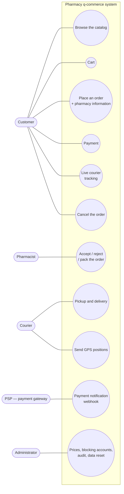

## Components

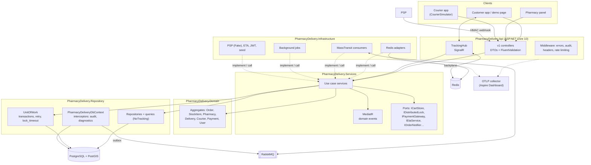

## Classes — domain model

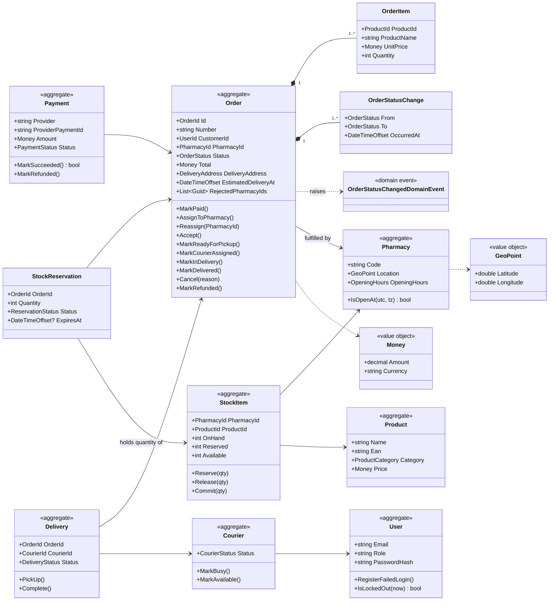

## Classes — service layer

```mermaid
classDiagram
    direction TB
    class ICheckoutService { <<interface>> +CheckoutAsync() }
    class IStockReservationService { <<interface>> +ReserveAsync() +ReleaseForOrderAsync() +CommitForOrderAsync() +ExpireAsync() }
    class IPaymentService { <<interface>> +StartAsync() +HandleWebhookAsync() +RefundCancelledOrderAsync() }
    class IPharmacyOrderService { <<interface>> +AcceptAsync() +RejectAsync() +MarkReadyAsync() +ProcessAcceptanceTimeoutsAsync() }
    class IDispatchService { <<interface>> +DispatchAsync() +RetryPendingAsync() }
    class ITrackingService { <<interface>> +IngestAsync() +GetSnapshotAsync() }
    class IAuthService { <<interface>> +LoginAsync() +RefreshAsync() +ChangePasswordAsync() }
    class IPharmacySelector { <<interface>> +SelectAsync() }
    class IUnitOfWork { <<interface>> +ExecuteInTransactionAsync() +SaveChangesAsync() }
    class IOrderRepository { <<interface>> }
    class IStockRepository { <<interface>> +LockAsync() }
    class IDistributedLock { <<interface>> +TryAcquireAsync() }
    class ICourierLocationStore { <<interface>> +FindNearestAsync() }
    class IOrderNotifier { <<interface>> }
    class IPaymentGateway { <<interface>> }

    ICheckoutService ..> IPharmacySelector
    ICheckoutService ..> IStockReservationService
    ICheckoutService ..> IUnitOfWork
    IStockReservationService ..> IStockRepository
    IPaymentService ..> IPaymentGateway
    IPharmacyOrderService ..> IPharmacySelector
    IDispatchService ..> ICourierLocationStore
    IDispatchService ..> IDistributedLock
    ITrackingService ..> IOrderNotifier
    ICheckoutService ..> IOrderRepository

    note for IUnitOfWork "PharmacyDelivery.Repository.Abstract — implementation: UnitOfWork (EF Core)"
    note for IDistributedLock "PharmacyDelivery.Services.Abstract — implementation: RedisDistributedLock"
```

## Sequences

### Checkout with pharmacy selection and reservation

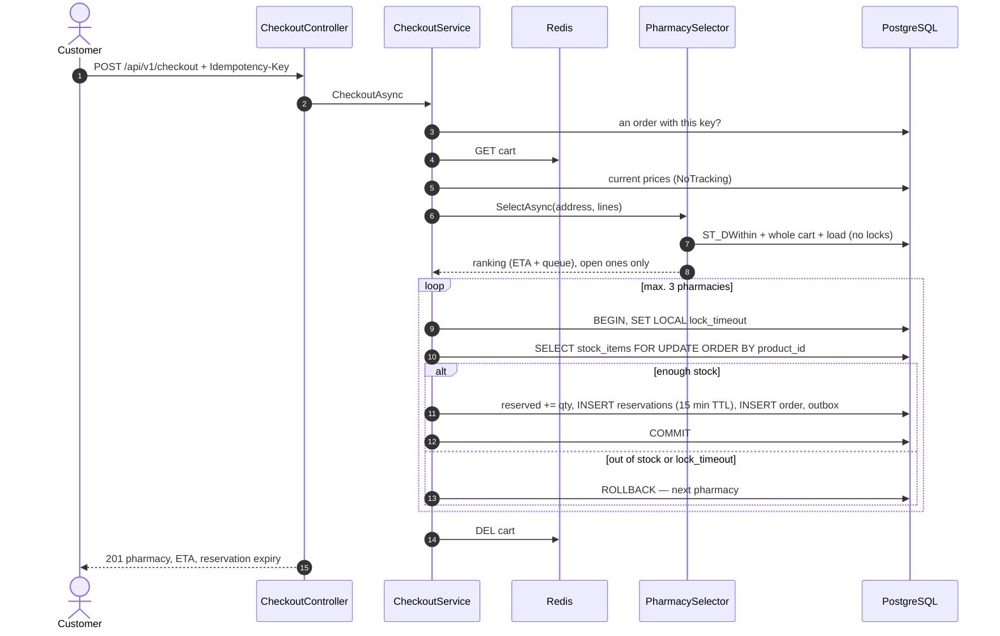

### Two concurrent checkouts for the same goods

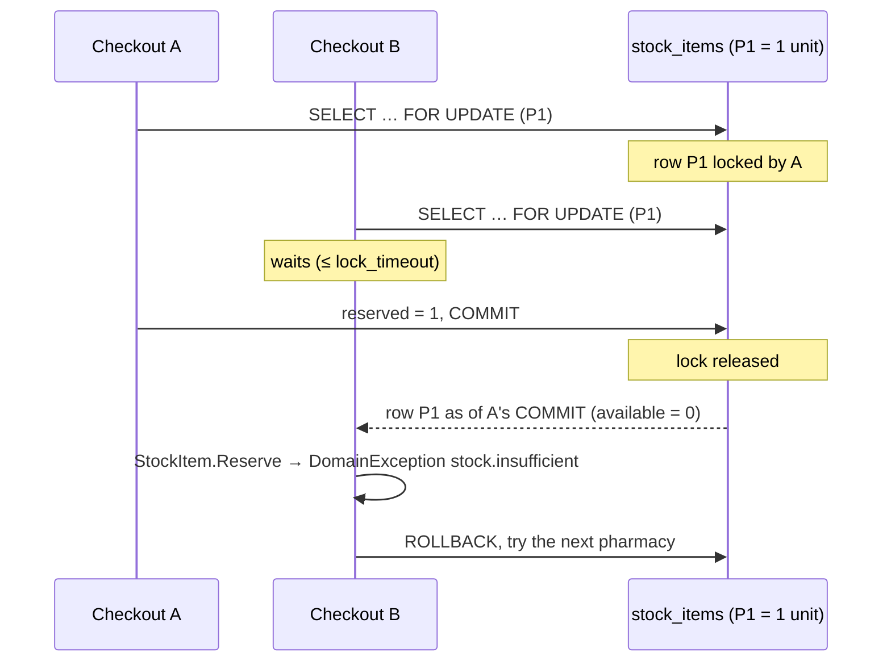

### Payment → outbox → RabbitMQ → consumer

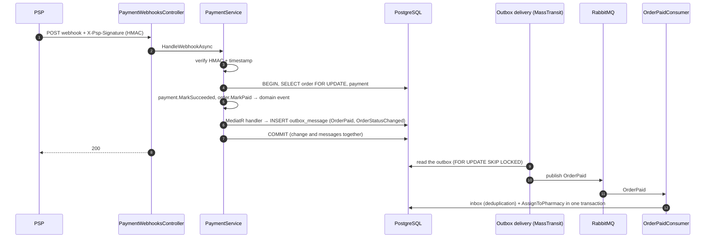

### Race: payment vs reservation expiry

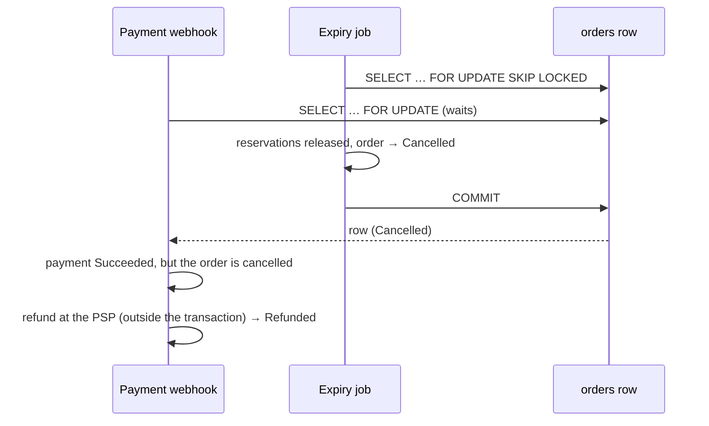

### Real-time courier tracking

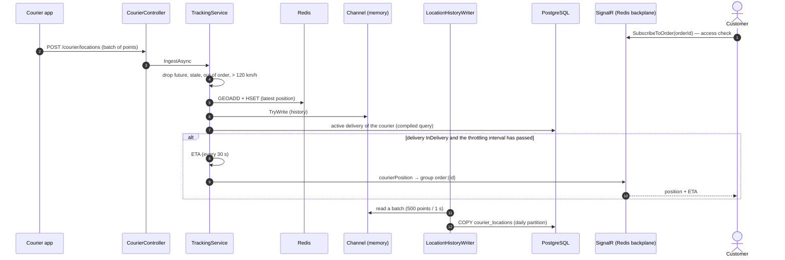

## States

### Order

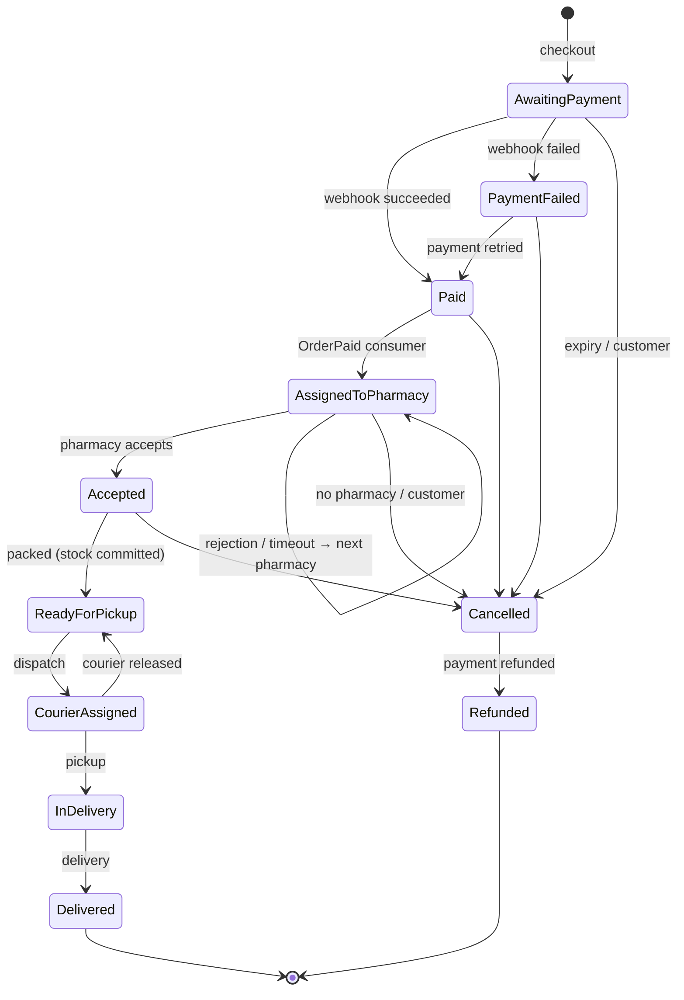

### Delivery

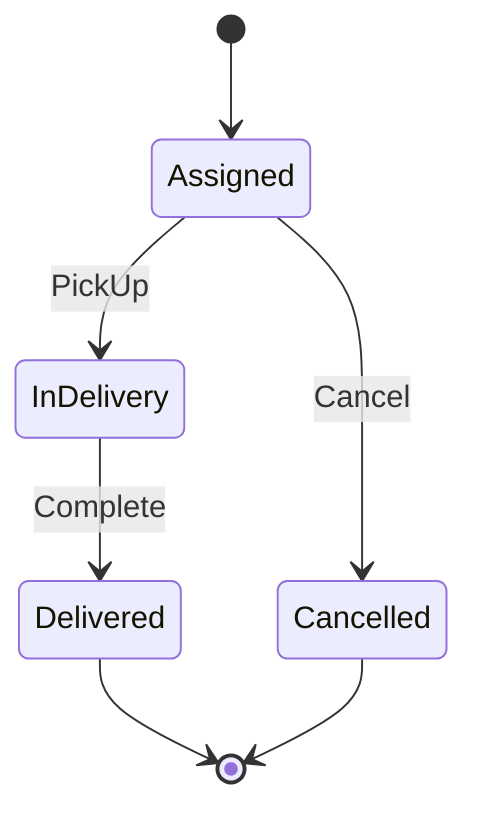

### StockReservation

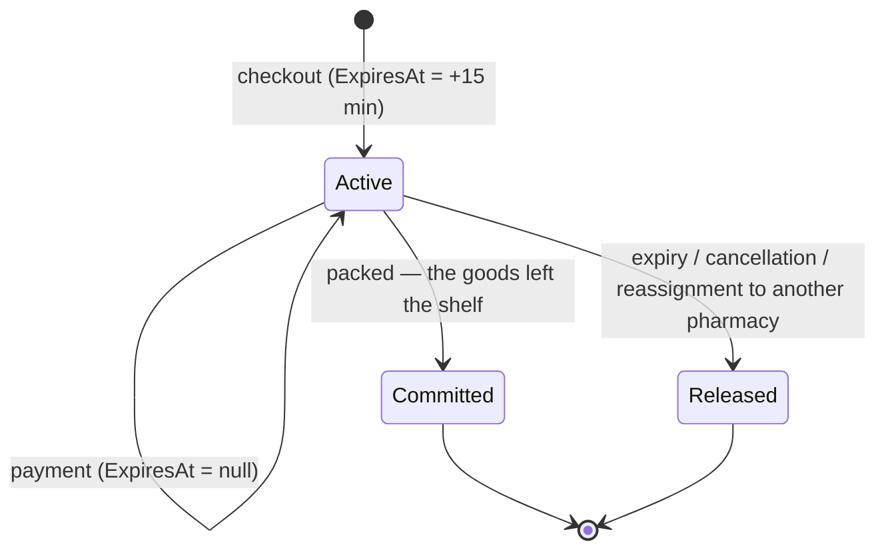

## Activities

### Pharmacy selection and order reassignment

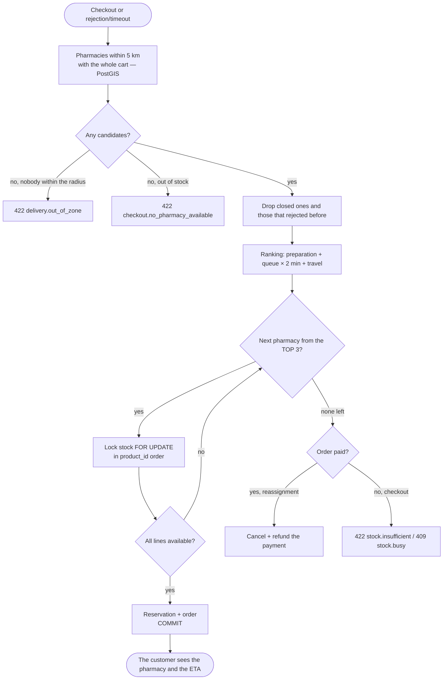

### Courier dispatch

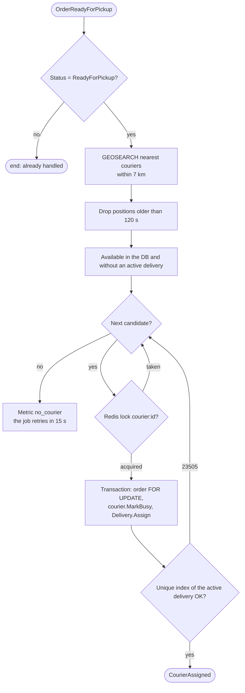

## Deployment

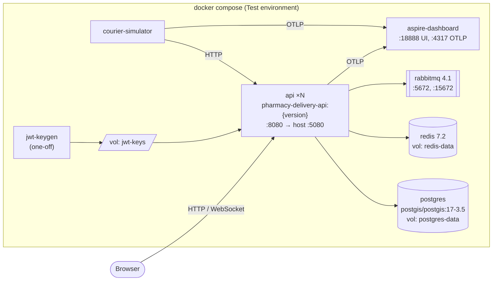

In production the same image runs in Kubernetes behind an ingress (TLS), with managed PostgreSQL/Redis/RabbitMQ and an OpenTelemetry collector → Grafana (Tempo/Prometheus/Loki) — see DESIGN.md §17.

## ER

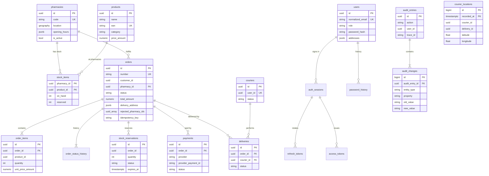

The MassTransit tables (`inbox_state`, `outbox_message`, `outbox_state`) and the attributes of `access_tokens`/`refresh_tokens` are left out for readability.
